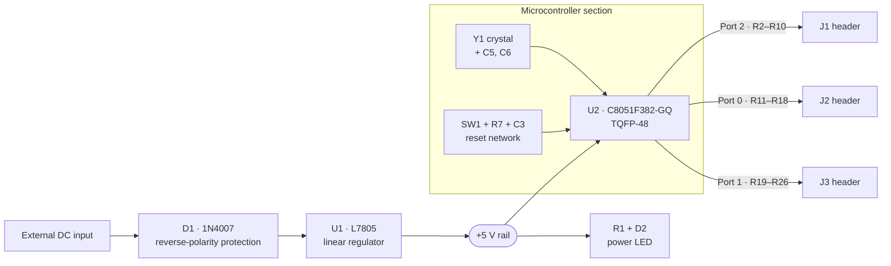

<div align="center">

# 🔌 8051 Microcontroller PCB

### A compact, stand-alone 8051 development board designed end-to-end in KiCad


-yellow)


</div>

---

## 📖 Table of Contents

1. [What is this project?](#-what-is-this-project)
2. [Key features](#-key-features)
3. [System architecture](#-system-architecture)
4. [Schematic](#-schematic)
5. [PCB layout](#-pcb-layout)
6. [3D views](#-3d-views)
7. [Bill of materials](#-bill-of-materials)
8. [Pin allocation](#-pin-allocation)
9. [Design audit: known issues & fixes](#-design-audit-known-issues--fixes)
10. [Roadmap (v2.0)](#-roadmap-v20)
11. [Bring-up & testing protocol](#-bring-up--testing-protocol)
12. [Repository structure](#-repository-structure)
13. [How to open the project](#-how-to-open-the-project)
14. [Author](#-author)

---

## 💡 What is this project?

Most 8051 learning setups are breadboards full of jumper wires, or bulky commercial evaluation boards with features you never use. This project replaces that with **a small, custom-designed PCB** built around a modern, high-speed 8051-compatible microcontroller, the **Silicon Labs C8051F382-GQ**.

The board gives you everything you need to start experimenting with embedded firmware:

- a regulated **+5 V power stage**,
- a **crystal clock** circuit,
- a **manual reset button**,
- and **24 I/O lines broken out** to three labelled headers, each protected by a series resistor.

The whole design was carried through the full hardware flow: **schematic → footprint assignment → netlist → placement → routing → verification → 3D inspection**, and then **critically audited**. The audit results (including real design mistakes we found and how to fix them) are documented honestly in this repository.

> 🎯 **Goal:** demonstrate a complete, professional PCB design workflow in open-source tools, and leave a clean reference that others can learn from, or build on.

---

## ✨ Key features

| | Feature | Details |
|---|---|---|
| 🧠 | **Modern 8051 core** | C8051F382-GQ, CIP-51 pipelined core, up to **48 MIPS**, 64 KB Flash, 4352 B RAM, SPI / UART / SMBus / USB 2.0 |
| ⚡ | **On-board regulation** | L7805 linear regulator (TO-220) with 1N4007 reverse-polarity protection diode and input/output capacitors |
| 🕒 | **External crystal clock** | HC-49/U crystal with two load capacitors (C5, C6) |
| 🔘 | **Manual reset** | Tactile push-button (SW1) with RC network (R7, C3) |
| 🔢 | **24 GPIO breakout** | Port 0, Port 1, Port 2 → three 1×9 headers (J1, J2, J3), each with 8 I/O + 1 × 5 V pin |
| 🛡️ | **Series protection** | One resistor on every I/O line (R2–R26) guards MCU pins from over-current and bus contention |
| 💡 | **Power LED** | LED D2 + R1 shows the board is energised |
| 📐 | **Manufacturable** | 2-layer FR-4, all SMD parts on the top side only, 0805 passives (hand-solderable) |

---

## 🧩 System architecture



The schematic is split into two clearly bordered blocks, **POWER SECTION** and **MICROCONTROLLER SECTION**, so power conditioning stays visually separate from the digital control paths.

---

## 📐 Schematic

<div align="center">

<br/><sub>Full schematic: <code>ESIM.kicad_sch</code> (KiCad Eeschema 6.0.11, A4)</sub>
</div>

**How the pieces fit together**

- **Power section.** The input passes through D1 (1N4007) into the L7805. C4 filters the regulator input; C1 and C2 filter the output. R1 + D2 form the power-on indicator.
- **Clock.** Crystal Y1 sits across the oscillator pins (P4.3 / P4.4) with load capacitors C5 and C6 to ground.
- **Reset.** SW1, C3 and R7 connect to pin 13 (`~RST/C2CK`).
- **I/O.** Ports 0, 1 and 2 each go through eight series resistors to a 9-pin header. Port 3, the USB pins and the unused Port 4 pins are marked with No-Connect flags.

---

## 🖥️ PCB layout

Board size is roughly **50 mm × 45 mm** (estimated by scaling from the 2.54 mm header pitch; no dimension annotations were exported). Placement follows signal flow:

- **U2 (MCU)** sits in the centre, keeping traces to all connectors short.
- **U1 + D1 (power)** sit in the upper-left corner, away from the sensitive digital area, so regulator heat stays isolated.
- **Y1 + C5/C6 (crystal)** sit right next to the MCU oscillator pins to keep traces short.
- **J1 / J2 / J3** sit on the board edges for easy cable access.

<div align="center">

| Front copper (F.Cu) | Back copper (B.Cu) |
|:---:|:---:|
|  |  |

</div>

**Routing summary**

| Parameter | Value |
|---|---|
| Layers | 2 (F.Cu + B.Cu), plated through-hole vias |
| Signal traces | ≈ 0.25 mm (10 mil) |
| Power traces | ≈ 0.50 – 0.75 mm (20–30 mil) |
| Clearance | ≈ 0.20 – 0.25 mm |
| Via | 0.80 mm pad / 0.40 mm drill |
| Ground | Copper pour on the top layer |

---

## 🧊 3D views

<div align="center">

| Top | Bottom |
|:---:|:---:|
|  |  |

</div>

All components are mounted on the **top side only**, so assembly needs just one SMD pass followed by hand or selective soldering of the through-hole parts. The bottom side has only solder joints and secondary routing.

---

## 🧾 Bill of materials

| Ref | Part | Value | Footprint | Role |
|---|---|---|---|---|
| U2 | Microcontroller | C8051F382-GQ | `TQFP-48_7x7mm_P0.5mm` | Core 8051 MCU |
| U1 | Voltage regulator | L7805 | `TO-220-3_Vertical` | +5 V linear regulator |
| D1 | Rectifier diode | 1N4007 | `D_DO41_SOD81_P10.16mm_Horizontal` | Reverse-polarity protection |
| D2 | LED | LED | `LED_0805_2012Metric` | Power indicator |
| SW1 | Push-button | tactile 6×6 mm | `SW_PUSH_6mm` | Manual reset |
| Y1 | Crystal | HC-49/U | `Crystal_HC49-U_Vertical` | System clock |
| J1, J2, J3 | 1×9 headers | 2.54 mm | `PinHeader_1x09_P2.54mm_Vertical` | Port 2 / Port 0 / Port 1 breakout |
| C1 – C6 | Capacitors | see schematic | `C_0805_2012Metric` | Decoupling, reset, crystal load |
| R1 | Resistor | – | `R_0805_2012Metric` | LED current limit |
| R7 | Resistor | – | `R_0805_2012Metric` | Reset network |
| R2–R6, R8–R10 | Resistors (8) | – | `R_0805_2012Metric` | Port 2 series protection |
| R11 – R18 | Resistors (8) | – | `R_0805_2012Metric` | Port 0 series protection |
| R19 – R26 | Resistors (8) | – | `R_0805_2012Metric` | Port 1 series protection |

> ℹ️ Component values for the passives are left generic (`resistor`, `capacitor`) in the schematic. Fill them in before ordering (see [Roadmap](#-roadmap-v20)).

---

## 📌 Pin allocation

| MCU pins | Signal | Connected to | Notes |
|---|---|---|---|
| 10 | VDD | +5 V rail | Main supply (see issue #3 below) |
| 11 | REGIN | No-Connect | Internal regulator input (see issue #3) |
| 13 | `~RST / C2CK` | SW1, C3, R7 | Active-low reset + C2 debug clock |
| 47, 48, 1–6 | P0.0 – P0.7 | R11–R18 → **J2** | Port 0 |
| 39 – 46 | P1.0 – P1.7 | R19–R26 → **J3** | Port 1 |
| 31 – 38 | P2.0 – P2.7 | R2–R10 → **J1** | Port 2 |
| 23 – 30 | P3.0 – P3.7 | No-Connect | Unused |
| 18, 19 | P4.4 / P4.3 | Y1, C5, C6 | Crystal oscillator |
| 8, 9, 12 | D+, D−, VBUS | No-Connect | USB unused in Rev 1.0 |

---

## 🔍 Design audit: known issues & fixes

We reviewed our own schematic and layout, and the audit found real problems. **Rev 1.0 should not be fabricated as-is.** They are listed here so the repository is honest and useful to learners.

| # | Severity | Issue | Why it matters | Fix |
|---|---|---|---|---|
| 1 | 🔴 **Critical** | The `+5V` net label is used on **both** the input side of D1 **and** the output of the L7805 | In KiCad, identical power labels are one net, so the regulator input and output are shorted together | Rename the input net to `VIN` (7–12 V DC) and keep `+5V` for the regulator output only |
| 2 | 🔴 **Critical** | **Reset polarity is wrong.** R7 pulls `~RST` (pin 13) to **GND** | `~RST` is active-low, so the MCU would be held in reset permanently | Make R7 a **pull-up to +5 V** (about 2.2 kΩ), and place SW1 + C3 between pin 13 and GND |
| 3 | 🟠 **High** | **REGIN (pin 11) is left floating** while +5 V feeds VDD | The C8051F382 core runs at 3.3 V; per the report's audit this violates the recommended operating conditions | Feed +5 V into **REGIN** and decouple VDD, as the datasheet's power-supply section describes |
| 4 | 🟡 Moderate | Silkscreen reference designators are stacked in columns at the board edges | Hard to assemble and debug by eye | Move labels next to their footprints |
| 5 | ⚪ Documentation | No DRC report or screenshot was archived | Cannot claim the layout passed DRC | Run DRC in Pcbnew and commit the report before ordering |

**Smaller observations**

- The schematic symbols for J1–J3 (`Screw_Terminal_01x09`) and SW1 (`SW_DIP_x02`) differ from the footprints actually used (pin headers and a tactile button). The wiring is electrically compatible, but the symbols should be updated to match.
- There is no dedicated programming header for the C2 debug interface (C2CK / C2D).
- There are no mounting holes in the board outline.
- Because the L7805 needs about 2 V of headroom, give it **7–12 V** input. A 9 V supply at 150 mA dissipates about 0.6 W, which is fine without a heatsink. At 12 V or 500 mA the dissipation rises enough that a heatsink is needed.

---

## 🛣️ Roadmap (v2.0)

- [ ] Re-label the external input as `VIN` and isolate it from `+5V`
- [ ] Add a 500 mA PTC resettable fuse on the input
- [ ] Correct the reset circuit (pull-up on `~RST`, switch to GND, 0.1 µF debounce capacitor)
- [ ] Route +5 V to **REGIN** and add proper VDD decoupling
- [ ] Add a **C2 programming header** (6- or 10-pin)
- [ ] Add native **USB** (Type-C or Micro-B with ESD protection) on pins 8, 9, 12
- [ ] Add four **M3 mounting holes** at the board corners
- [ ] Relocate silkscreen labels beside their footprints
- [ ] Fill in all component values in the schematic
- [ ] Run DRC/ERC and archive the reports in the repo
- [ ] Add Gerber files and an interactive BOM

---

## 🧪 Bring-up & testing protocol

Once a corrected board is assembled, follow these steps **in order** before applying full power:

1. **Visual inspection.** Check under a microscope for solder bridges, especially between the 0.5 mm TQFP pins.
2. **Cold resistance check.** Measure +5 V to GND with a multimeter. It should read kΩ, not a short.
3. **First power-on.** Use a current-limited bench supply (about 50 mA limit, 9 V in). Confirm D2 lights and U1 pin 3 reads +5.0 V ± 0.1 V.
4. **Reset check.** Pin 13 should read +5 V at idle and drop to 0 V while SW1 is pressed.
5. **Clock check.** Probe the crystal pins with a 10× scope probe and look for a clean oscillation.
6. **Firmware test.** Connect a C2 programmer, confirm the device ID, flash a GPIO toggle program and check the square waves on J1, J2 and J3.

---

## 📁 Repository structure

```
8051-pcb/
├── README.md                  ← you are here
├── ESIM.kicad_sch             ← KiCad schematic (add your project files)
├── *.kicad_pcb                ← KiCad PCB layout
├── images/
│   ├── schematic.jpeg
│   ├── front_layout.jpeg
│   ├── back_layout.jpeg
│   ├── 3D_front.jpeg
│   └── 3D_back.jpeg
└── docs/
    └── 8051_Microcontroller_PCB_Design_Report.pdf   ← full technical report & audit
```

> 📄 For the complete write-up (circuit theory, thermal calculations, IPC-2221 track analysis, DFM notes), read the [full design report](docs/8051_Microcontroller_PCB_Design_Report.pdf).

---

## 🚀 How to open the project

1. Install **[KiCad 6.0 or newer](https://www.kicad.org/download/)**.
2. Clone this repository:
   ```bash
   git clone https://github.com/<your-username>/<your-repo>.git
   cd <your-repo>
   ```
3. Open the project file in KiCad:
   - **Eeschema** → view and edit the schematic
   - **Pcbnew** → view the layout
   - **3D Viewer** (`Alt + 3` in Pcbnew) → inspect the assembled board
4. Before any fabrication, apply the fixes in the [audit table](#-design-audit-known-issues--fixes) and run **ERC + DRC**.

---

## 🛠️ Tools used

| Tool | Purpose |
|---|---|
| KiCad 6.0.11 (Eeschema, Pcbnew, 3D Viewer) | Schematic, layout and 3D inspection |
| eSim toolchain | Integrated design environment |
| Silicon Labs C8051F382 datasheet | Pinout and power requirements |

---

## 👤 Author

**Shathish**
B.E. Electronics & Communication Engineering (VLSI Design Technology), Chennai Institute of Technology

---

<div align="center">

If this project helped you learn something, consider giving it a ⭐

*Built with KiCad · Documented honestly · Open for improvement*

</div>
