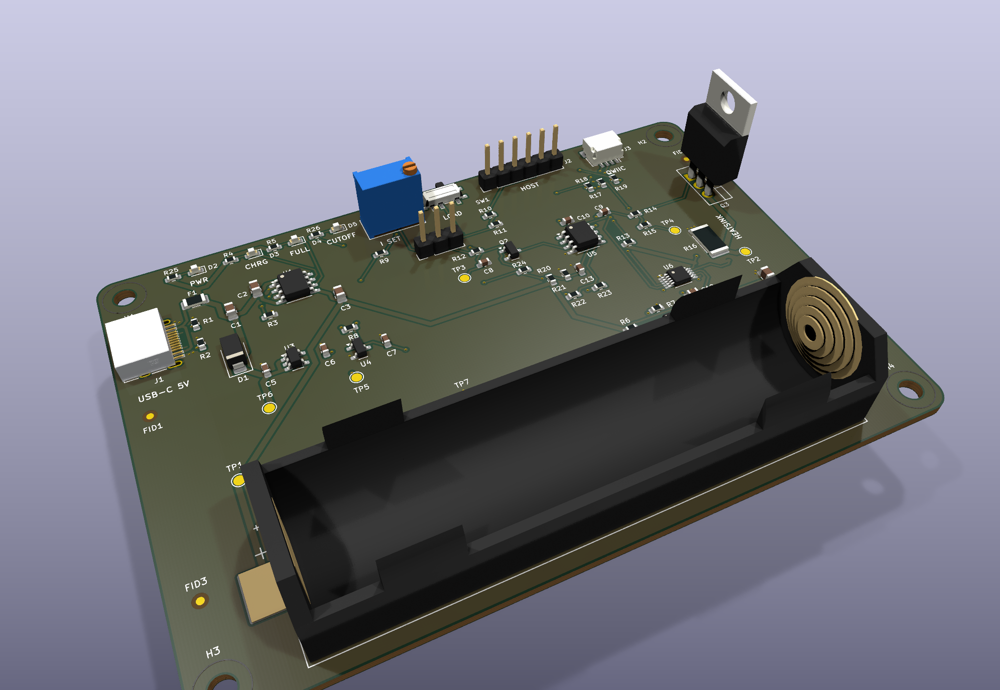
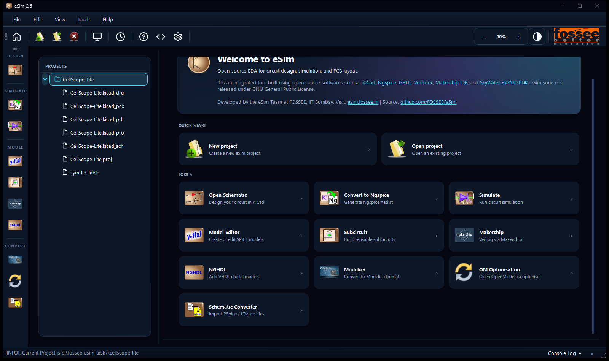
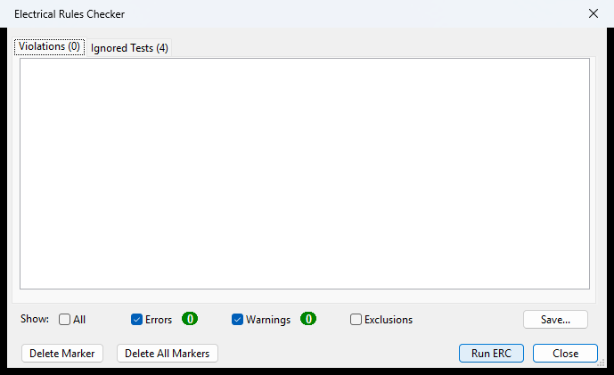
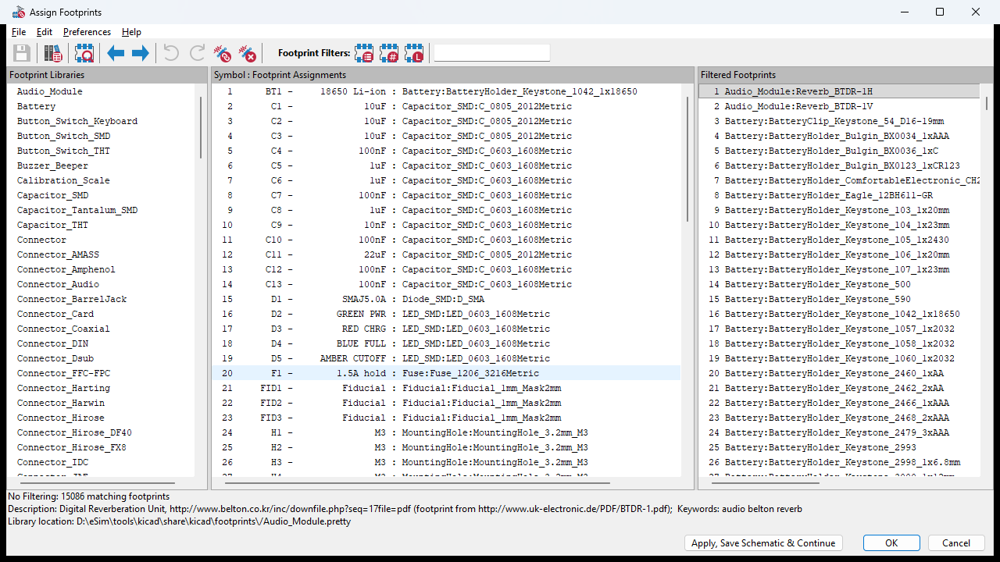
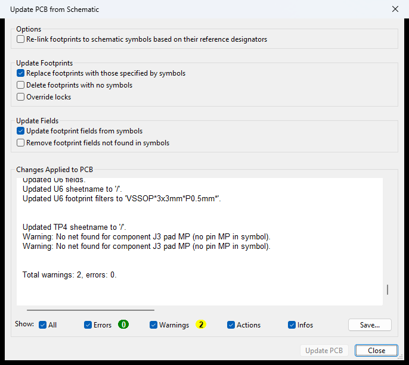
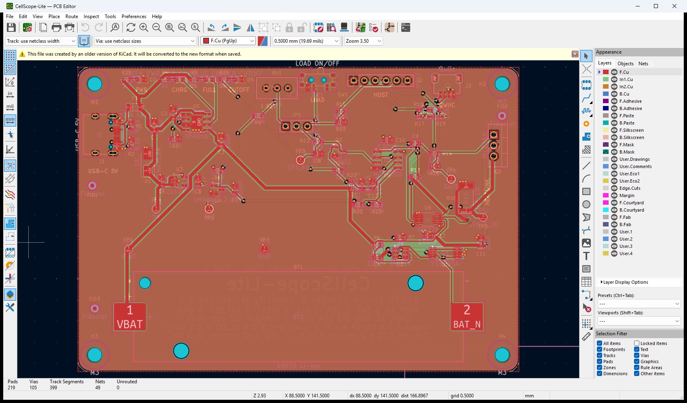
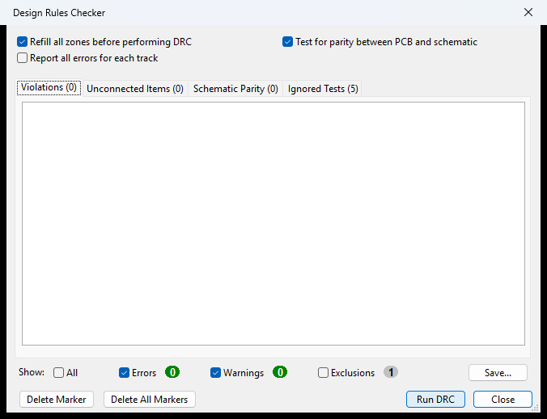
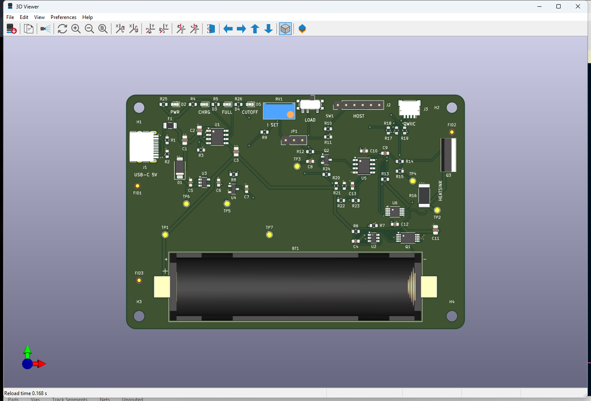
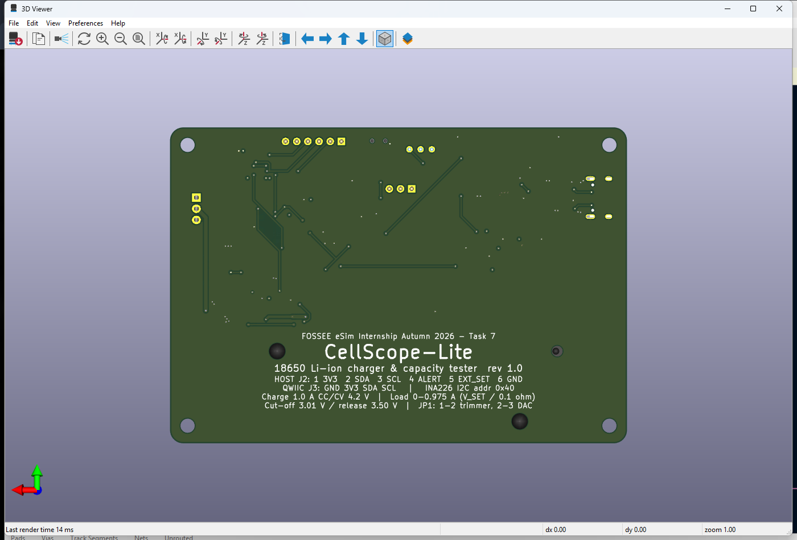

# CellScope-Lite: 18650 Li-ion Charger & Capacity Tester (4-layer PCB in eSim)

**FOSSEE eSim Semester Long Internship - Autumn 2026, Task 7: PCB Design using eSim**

Author: **Karthik M Achalakar**, B.E. Electrical and Electronics Engineering, Ramaiah Institute of Technology, Bengaluru

CellScope-Lite charges a single 18650 Li-ion cell at 1 A. It then discharges the cell at a precise,
adjustable constant current (0–0.975 A) and stops automatically at 3.0 V. An on-board INA226 reports
voltage, current and power over I²C, so the cell's true capacity (mAh / mWh) can be measured.
The full design (schematic, footprints, 4-layer PCB, DRC and 3D) was done in **eSim**
(eSchema + the KiCad PCB editor bundled with eSim). The analog behaviour was verified with
**Ngspice**, the simulator inside eSim.

> **eSim version compatibility.** The work was done in eSim 2.6, and the project is saved in the
> **KiCad 6.0 file format** used by **eSim 2.4 / 2.5** (schematic `20211123`, board and symbol library `20211014`).
> KiCad 6.0 refuses files from newer versions, while newer KiCad opens 6.0 files, so the same folder opens in
> **eSim 2.5 and eSim 2.6** without changes. All 27 footprints exist in the KiCad 6.0.11 libraries.
> The conversion and how it was verified are described in report section 9 (`tools/to_kicad6.py`, `tools/check_kicad6.py`).

## Results at a glance
| Check | Result |
|---|---|
| ERC (eSchema) | **0 errors, 0 warnings** |
| DRC (PCB editor, all severities) | **0 errors, 0 warnings, 0 unconnected items** (+1 documented exclusion, see below) |
| Schematic to PCB parity | **0 issues** (Update PCB from Schematic: 0 errors) |
| File format | KiCad 6.0 (opens in eSim 2.5 and 2.6) |
| Board | 104 x 72 mm, **4 layers** (signal / GND plane / 3V3 plane / signal) |
| Parts / nets | 76 footprints, 39 named nets, 3 custom symbols |
| Routing | 399 track segments (871 mm), 105 vias, 100 % routed |
| Ngspice: CC loop | I = V_SET / 0.1 ohm within **0.14 %** (0-100 mV sweep) |
| Ngspice: UVLO | trip **3.017 V**, release **3.490 V** (calculated 3.01 / 3.50 V) |




## Repository layout
```
CellScope-Lite/                 <- open this folder in eSim (2.5 or 2.6)
  CellScope-Lite.proj           eSim project anchor (lets eSim "Open Project" recognise the folder)
  CellScope-Lite.kicad_pro      KiCad project (net classes, design rules)
  CellScope-Lite.kicad_sch      schematic (A2, 9 functional blocks + design-equation panel)
  CellScope-Lite.kicad_pcb      4-layer PCB, routed, zones filled
  CellScope-Lite.kicad_prl      local project settings
  CellScope-Lite.kicad_dru      custom DRC rules (INA226 fine-pitch exception, mounting-hole keep-out)
  sym-lib-table                 project symbol library table
  libraries/CellScopeLite.kicad_sym   custom symbols: TP4056, DW01A, FS8205A
  3dmodels/                     STEP/VRML models used by the 3D viewer (bundled; eSim ships none)
docs/
  CellScope-Lite_Proposal.pdf         PCB design proposal (idea, functionality, PCB plan)
  CellScope-Lite_Task7_Report.pdf     full report (overview, schematic, PCB, DRC, 3D, simulation)
  DESIGN_NOTES.md                     block-by-block design explanation and equations
  img/                                renders and screenshots used in the report
sim/                            Ngspice netlists + results (CC loop, linearity, UVLO hysteresis)
fab/                            Gerbers, drill files, BOM, pick-and-place (manufacturing outputs)
tools/                          scripts used to check and regenerate the design (see below)
```

## How to open and check the design in eSim
1. Install eSim 2.5 or 2.6 (https://esim.fossee.in/downloads).
2. Start **eSim**, choose **Open Project**, and select the `CellScope-Lite` folder.
3. **Schematic**: click *Schematic Editor* (eSchema). Run *Inspect → Electrical Rules Checker*; the result is 0 errors and 0 warnings.
4. **Footprints**: in eSchema, open *Tools → Assign Footprints*. Every symbol already has a footprint from the standard KiCad libraries (all present in KiCad 6.0).
5. **Sch → PCB**: open the *PCB Editor*. Run *Tools → Update PCB from Schematic* (F8); it reports no changes, because the board is in sync.
6. **DRC**: in the PCB Editor run *Inspect → Design Rules Checker*, with "Refill all zones" and "Test for parity" ticked.
7. **3D**: *View → 3D Viewer* (Alt+3). The 3D models load from the project's own `3dmodels/` folder.

Command-line check with eSim 2.6's bundled KiCad (KiCad 6.0 has no `kicad-cli`; in eSim 2.5 use the GUI steps above):
```
D:\eSim\tools\kicad\bin\kicad-cli.exe sch erc CellScope-Lite\CellScope-Lite.kicad_sch
D:\eSim\tools\kicad\bin\kicad-cli.exe pcb drc --schematic-parity CellScope-Lite\CellScope-Lite.kicad_pcb
```

## eSim GUI flow (screenshots)
Taken in eSim 2.6 and its bundled KiCad. The schematic, ERC, PCB, DRC and 3D shots show the final KiCad 6.0-format files (note the "created by an older version of KiCad" banner). All files are in [`docs/img/esim_gui/`](docs/img/esim_gui/).

**DRC exclusion (1):** eSim 2.6 (KiCad 7+) compares footprints with their library copies. The stock NetTie footprint has the attribute `allow_missing_courtyard`, which the KiCad 6.0 format cannot store, so NT1 is reported as "not matching the library". Copper and pads are identical, KiCad 6.0 (eSim 2.5) does not run this check, and it is recorded as an exclusion in the project file.

| Step | Screenshot |
|---|---|
| Project opened in eSim |  |
| ERC: 0 errors / 0 warnings |  |
| Assign Footprints |  |
| Update PCB from Schematic: 0 errors |  |
| Routed board (0 unrouted) |  |
| DRC + parity: 0 / 0 / 0 (1 exclusion) |  |
| 3D viewer, top / bottom |   |

## Simulation (Ngspice inside eSim)
```
D:\eSim\tools\ngspice\bin\ngspice_con.exe -b sim\cc_load_uvlo.cir     (transient: CC steps + cut-off)
D:\eSim\tools\ngspice\bin\ngspice_con.exe -b sim\cc_linearity.cir     (DC: I_LOAD vs V_SET)
D:\eSim\tools\ngspice\bin\ngspice_con.exe -b sim\uvlo_threshold.cir   (DC sweeps: trip / release)
python sim\plot_sim.py
```

## Tools used
* **eSim 2.6** (design work): eSchema, PCB editor, 3D viewer, Ngspice 45.2. Files saved in KiCad 6.0 format for eSim 2.4 / 2.5.
* KiCad stock symbol and footprint libraries (as shipped with eSim), plus a small project library for three
  parts that are not in the stock libraries (TP4056, DW01A, FS8205A), built from their datasheets.
* Python helper scripts in `tools/` that run inside eSim's bundled KiCad Python (`pcbnew` API) for repeatable
  netlist verification, placement and routing. Every result is a standard eSim/KiCad file and can be
  edited in the GUI. See the report's "Routing method" section.

## License
CERN-OHL-S v2 for the hardware design files; MIT for the scripts in `tools/` and `sim/`.
