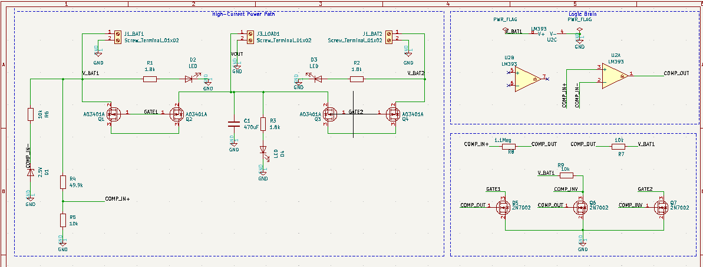
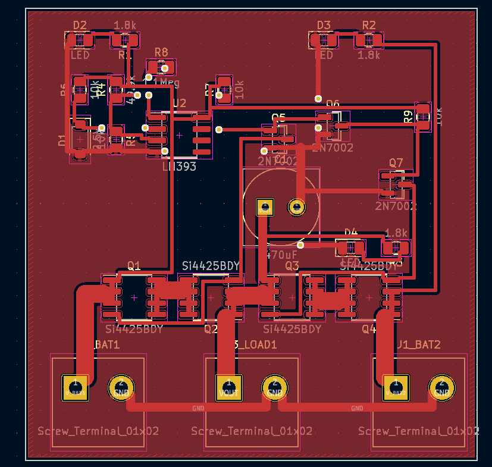
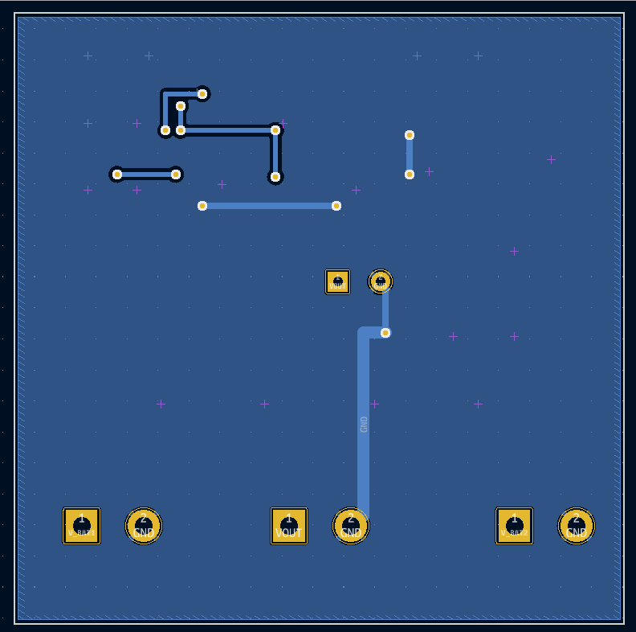
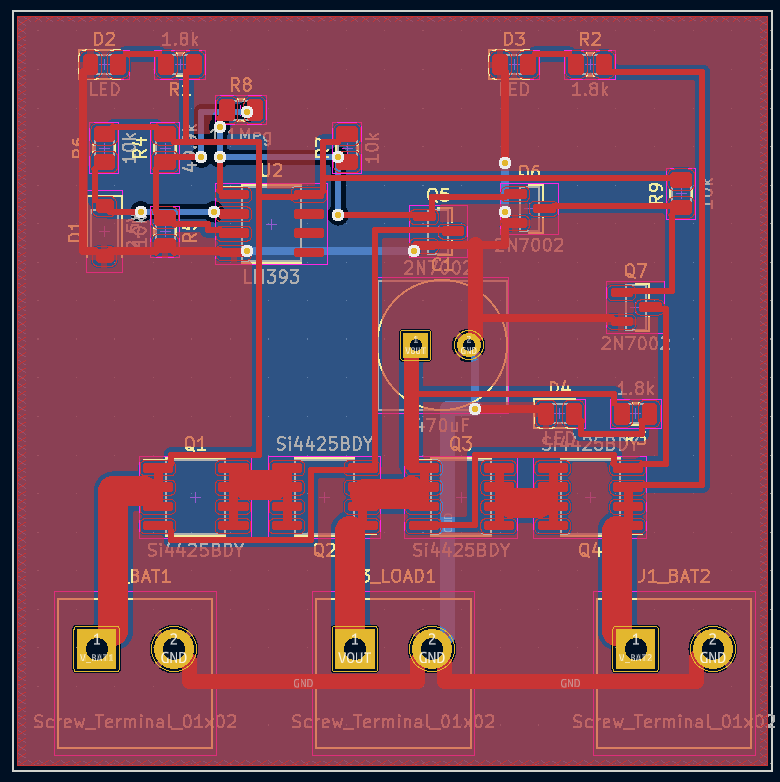
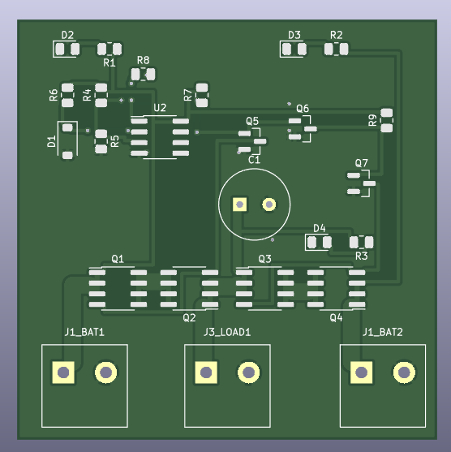
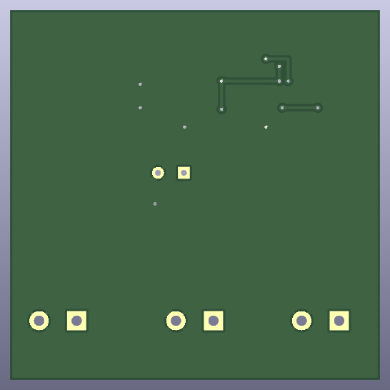
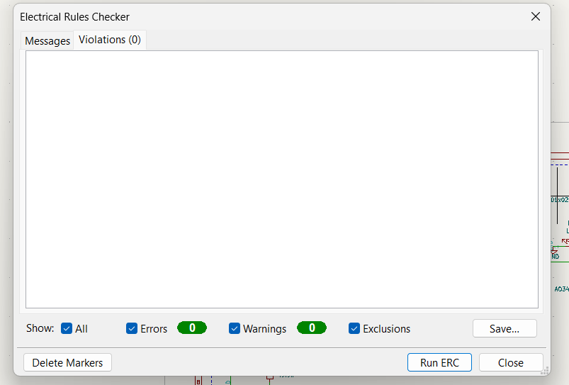
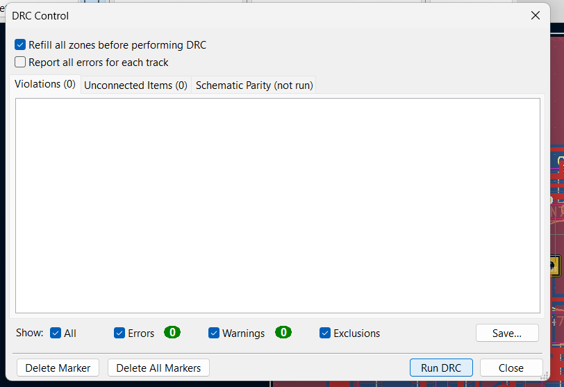
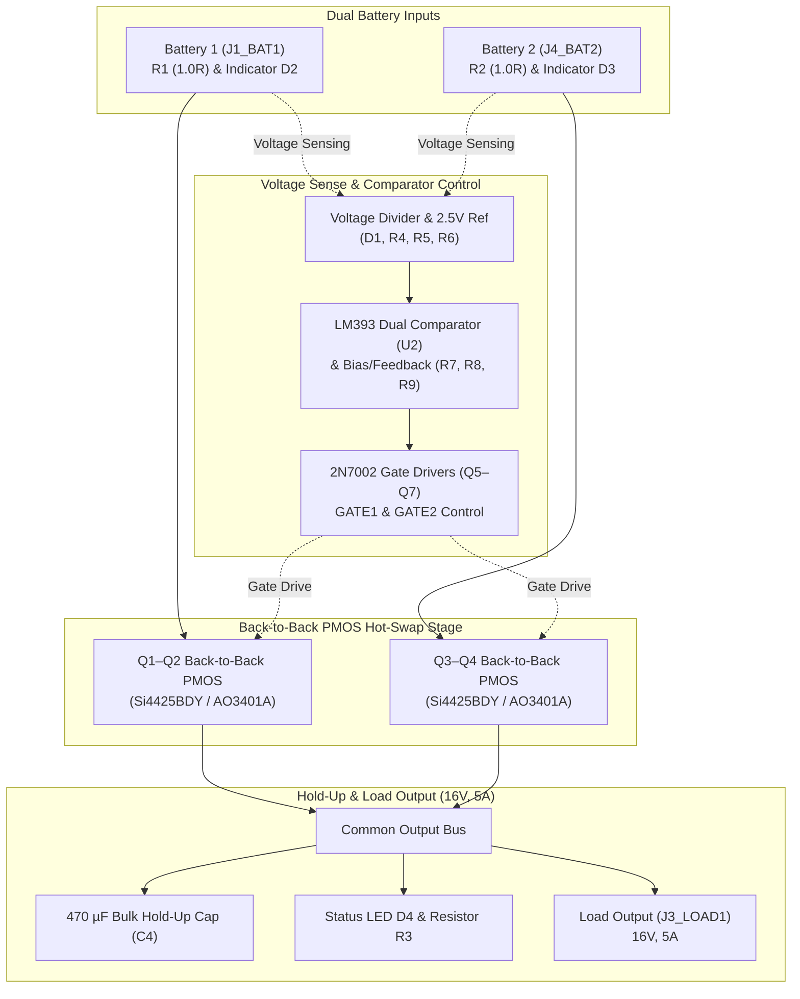

# Dual-Battery Automatic Hot-Swap Circuit (2-Layer PCB)

A compact **Dual-Battery Automatic Hot-Swap Circuit** PCB designed for a **16 V, 5 A load** using **eSim 2.5 / KiCad 6.0.11**. The board connects two battery inputs (`J1_BAT1` and `J4_BAT2`) to a shared load output (`J3_LOAD1`) with voltage sensing, comparator control, MOSFET switching, and a bulk hold-up capacitor (`C4`) so power to the load stays smooth during battery switching.

**Author:** MD Hazijul Haque

**Program:** FOSSEE eSim Winter Internship 2026 (Task 7)

**Project Folder:** `Dual_Battery_Hot_Swap_PCB/` (`Hotswap_Task7`)

**Project Report:** [Hotswap_Task7_Report.pdf](https://github.com/Hazijul/eSim_PCB_Design_Hot_Swap_File/blob/main/Dual_Battery_Hot_Swap_PCB/Hotswap_Task7_Report.pdf)

**Repository & PR:** [Hazijul/eSim_PCB_Design_Hot_Swap_File](https://github.com/Hazijul/eSim_PCB_Design_Hot_Swap_File/tree/main/Dual_Battery_Hot_Swap_PCB) (`Dual_Battery_Hot_Swap_PCB/`) — [Pull Request #49 on FOSSEE/eSim_PCB_Design_Project_Files](https://github.com/FOSSEE/eSim_PCB_Design_Project_Files/pull/49)
---

## Hardware Specifications

| Parameter | Specification |
| :--- | :--- |
| **Voltage & Current Rating** | **16 V**, **5 A** load capability |
| **Battery Inputs** | Dual battery terminals (`J1_BAT1`, `J4_BAT2`) |
| **Load Output** | Shared load terminal (`J3_LOAD1`) |
| **Voltage Comparator** | **LM393** dual comparator (`U2A`, `U2B`, `U2C` power/ground) with **2.5 V** reference (`D1`) |
| **Power Switching MOSFETs** | Back-to-back P-channel MOSFETs (`Q1–Q4`, `Si4425BDY` / `AO3401A` in KiCad 6) |
| **Gate Drive MOSFETs** | N-channel MOSFET switches (`Q5–Q7`, `2N7002`) |
| **Hold-Up & Sense Parts** | **470 µF** bulk hold-up capacitor (`C4`), path/sense resistors (`R1`, `R2`), divider/bias network (`R4–R9`), indicators (`D2`, `D3`, `D4`, `R3`) |
| **PCB Stackup & Size** | **50 mm × 50 mm**, **2-Layer FR4** (`F.Cu` & `B.Cu`) |
| **Verification Tool** | eSim 2.5 / KiCad 6.0.11 (`ERC.rpt` & `DRC.rpt` with 0 errors) |

---

## Schematic Explanation

The schematic (`Hotswap_Task7.kicad_sch`) is divided into clear functional sections so anyone reading the circuit can see how battery inputs are sensed, how switching decisions are made, and how power reaches the load.

### 1. Dual Battery Inputs & Power Path
- **Two Battery Channels (`J1_BAT1` and `J4_BAT2`):** Two screw-terminal battery inputs feed into the hot-swap circuit so the system can draw from dual battery sources.
- **Series Resistors & Indicators (`R1`, `R2`, `D2`, `D3`):** Each battery branch includes its path/sense resistor (`R1`, `R2` at `1.0R`) and status LED (`D2`, `D3`) so you can tell at a glance which battery path is active or present.
- **Shared Load Output (`J3_LOAD1`):** Both battery paths feed into the main load output (`J3_LOAD1`) along with a load/status indicator branch (`R3` and `D4`).

### 2. Voltage Sensing & LM393 Comparator Logic
- **Reference & Voltage Divider (`D1`, `R4`, `R5`, `R6`):** A **2.5 V** reference (`D1`) and resistor divider network (`R4`, `R5`, `R6`) provide a steady comparison threshold and scaled voltage input (`COMP_IN+` / `COMP_IN-`) for monitoring battery voltage.
- **Comparator & Biasing (`U2A`, `U2B`, `U2C`, `R7`, `R8`, `R9`):** The **LM393** dual comparator compares the sensed voltage against the reference/threshold and drives the comparator output (`COMP_OUT`) with supporting bias and feedback resistors (`R7`, `R8`, `R9`).

### 3. Gate Drive & Back-to-Back MOSFET Switching
- **N-Channel Gate Drivers (`Q5–Q7`, `2N7002`):** The `2N7002` N-channel MOSFETs (`Q5`, `Q6`, `Q7`) act as small control switches driven by the comparator/logic signals (`COMP_OUT`, `COMP_INV`) to control the gate lines (`GATE1`, `GATE2`) of the main power MOSFETs.
- **Back-to-Back P-Channel MOSFETs (`Q1–Q4`):** Four P-channel MOSFETs (`Q1–Q2` on one path and `Q3–Q4` on the other) are arranged back-to-back. Using back-to-back MOSFETs blocks unwanted reverse current flow through the internal body diode when a channel is turned off or when one battery has a different voltage than the other.

### 4. Bulk Hold-Up Capacitor (`C4`)
- **Smoothing During Switchover:** A **470 µF** bulk capacitor (`C4`) sits on the output side toward the load (`J3_LOAD1`). When switching between battery sources or hot-swapping a pack, `C4` helps buffer brief current dips so the load sees a steadier voltage transition.

### Circuit Schematic

---

## PCB Design & Layout Explanation

The 2-layer PCB (`Hotswap_Task7.kicad_pcb`) fits everything into a compact **50 mm × 50 mm** square board while keeping high-current paths clear and organized.

### 1. Compact 50 mm × 50 mm Board Layout
- **Connectors & Accessibility:** Battery connectors (`J1_BAT1`, `J4_BAT2`) and the load output (`J3_LOAD1`) are placed cleanly around the board edges so wiring a 16 V, 5 A setup is straightforward.
- **Logical Grouping:** Power path components (`J1_BAT1`, `J4_BAT2`, `J3_LOAD1`, `Q1–Q4`, `R1`, `R2`, `C4`) sit close together along the high-current path, while the `LM393` comparator (`U2`), reference/divider resistors, and `2N7002` drivers (`Q5–Q7`) are grouped neatly nearby.

### 2. Handling 5 A Current Safely on a 2-Layer Board
A **5 A** load current on a 2-layer board requires wider, shorter copper paths than low-current signal traces:
- **Wider High-Current Copper:** The battery-to-MOSFET-to-load (`VOUT`) and ground return paths use wider traces/copper areas to reduce resistance, voltage drop, and heating at 5 A.
- **Short Loops:** Keeping `Q1–Q4`, `R1`/`R2`, and the `470 µF` capacitor (`C4`) close to `J1_BAT1`, `J4_BAT2`, and `J3_LOAD1` keeps high-current loops tight and tidy.

### 3. Separating Comparator & Gate Signals from High-Current Paths
- **Clean Sensing & Control:** Voltage-divider and comparator lines carry small reference/sense signals, while `Q5–Q7` drive `GATE1` and `GATE2`. Routing these cleanly away from heavy current paths reduces unwanted noise pickup.
- **Ground Reference:** A broad ground copper fill on the board gives return currents a low-resistance path and keeps reference measurements consistent.

### 4. Design Verification (ERC & DRC)
Two checks in eSim 2.5 / KiCad 6.0.11 verify the schematic and PCB before release:
- **Electrical Rules Check (`ERC.rpt`):** Confirms schematic connections and symbol references have **0 errors**.
- **Design Rules Check (`DRC.rpt`):** Confirms physical track widths, clearances, drill/pad rules, and copper pours on the 50 mm × 50 mm board pass with **0 errors**.

### Quick Summary of Circuit & Layout Blocks

| Block / Section | Key Parts | Role in the Circuit |
| :--- | :--- | :--- |
| **Battery & Load Terminals** | `J1_BAT1`, `J4_BAT2`, `J3_LOAD1` | Connects Battery 1, Battery 2, and the 16 V / 5 A load |
| **Voltage Sense & Comparator** | `LM393` (`U2`), `D1` (2.5 V), `R4–R9` | Monitors battery voltage against threshold/reference and drives control logic |
| **Gate Drive & Power Switches** | `Q1–Q4` (PMOS), `Q5–Q7` (`2N7002`), `R1`, `R2` | Switches battery paths smoothly with back-to-back reverse-blocking protection |
| **Hold-Up & Indicators** | `C4` (`470 µF`), `D2`, `D3`, `D4`, `R3` | Supports load voltage during switchover and shows status visually |

### 2-Layer PCB Layout (Front, Back & Both Layers)

### 3D PCB Render (Front & Back)

---

## Verification Results (ERC & DRC)

Both schematic ERC and PCB DRC were run and verified with **0 errors** in eSim 2.5 / KiCad 6.0.11, with full text reports saved as `ERC.rpt` and `DRC.rpt` inside this folder.

### Electrical Rules Check (ERC)

### Design Rules Check (DRC)

---

## System Working Flow

### Stage-by-Stage Operation

| Stage | Components Involved | Function |
| :--- | :--- | :--- |
| **1. Battery Input & Sensing** | `J1_BAT1`, `J4_BAT2`, `R1`, `R2`, `D1`, `R4–R6` | Battery voltages enter through `J1_BAT1` and `J4_BAT2` and are sensed against the reference/divider network so the control stage knows the battery state. |
| **2. Comparator & Gate Control** | `LM393` (`U2`), `R7–R9`, `Q5–Q7` (`2N7002`) | The `LM393` comparator evaluates the sensed inputs and drives `Q5–Q7` to control `GATE1` and `GATE2` cleanly. |
| **3. Hot-Swap Switching** | `Q1–Q4` (Back-to-Back PMOS) | Back-to-back P-channel MOSFETs switch power between battery channels while blocking reverse current flow. |
| **4. Hold-Up & Load Delivery** | `C4` (`470 µF`), `R3`, `D2–D4`, `J3_LOAD1` | The `470 µF` capacitor (`C4`) helps steady the output during switching as power reaches the load at `J3_LOAD1`, with LEDs indicating status. |

---

## Project Files Included
- `Hotswap_Task7.kicad_pro`, `Hotswap_Task7.proj`, `Hotswap_Task7.kicad_sch`, `Hotswap_Task7.kicad_pcb`
- `sym-lib-table` and `New_Library.kicad_sym`
- `ERC.rpt`, `DRC.rpt`, and `Hotswap_Task7_Report.pdf`
- Schematic, PCB, 3D, and ERC/DRC verification images: `Schematic.png`, `Pcb_Front.png`, `Pcb_back.png`, `Pcb_both_layer.png`, `Hotswap3D_front.png`, `Hotswap3D_back.png`, `ERC_img.png`, and `DRC_img.png`
