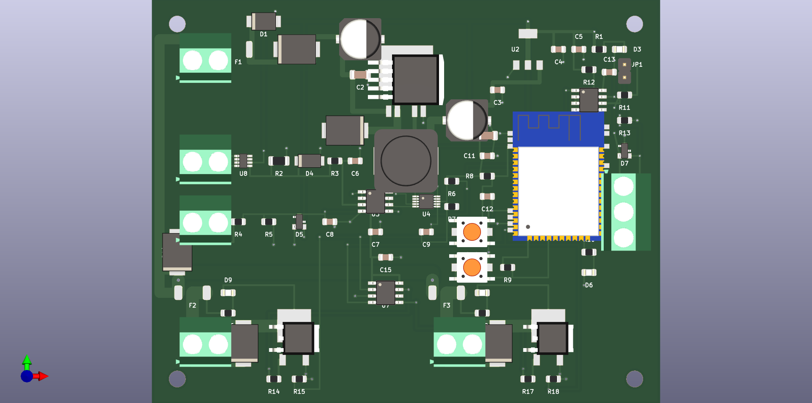
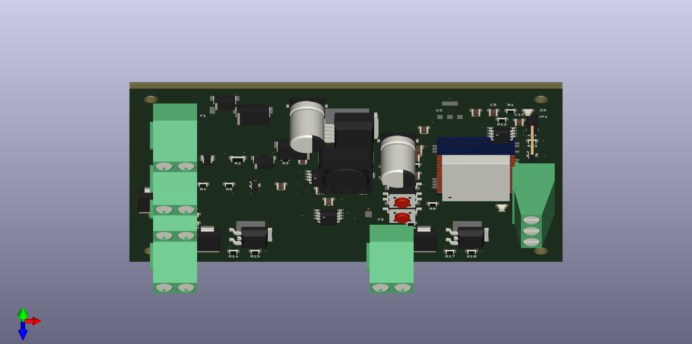
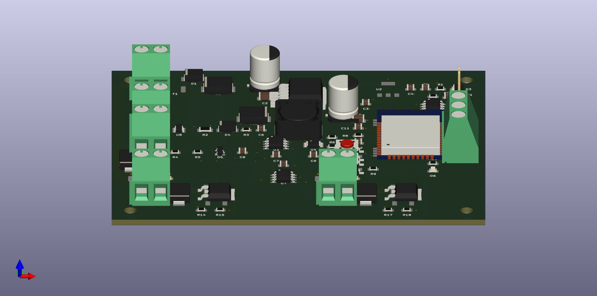
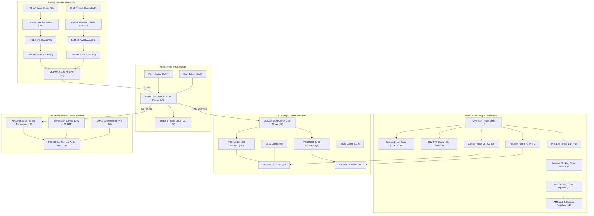
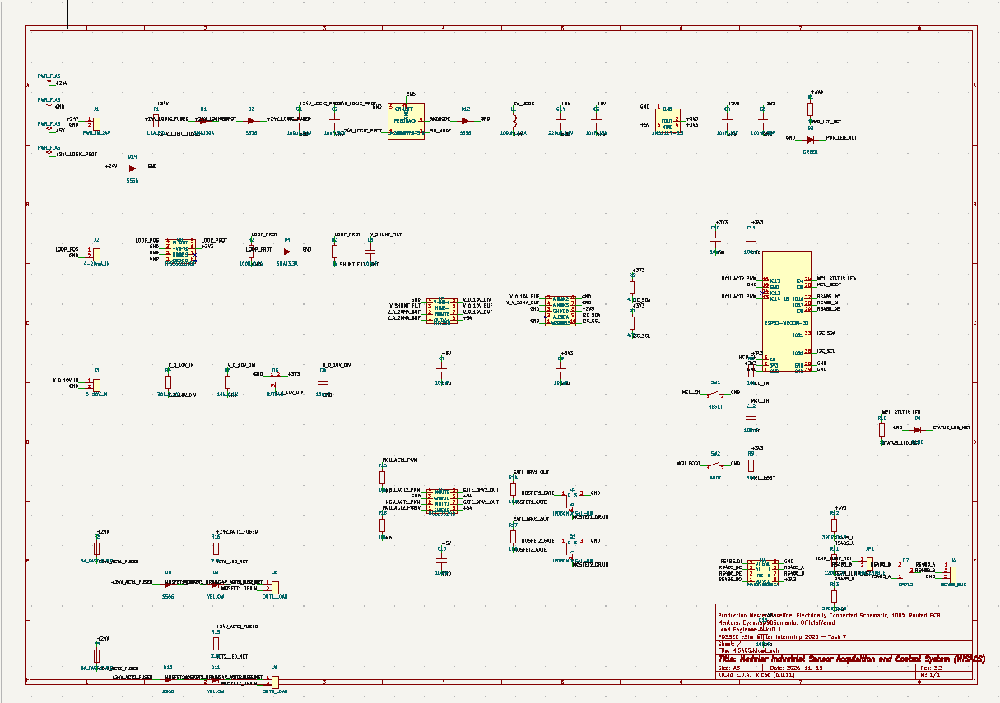
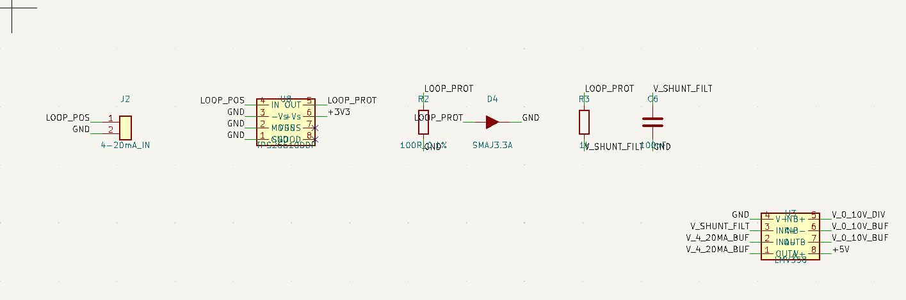
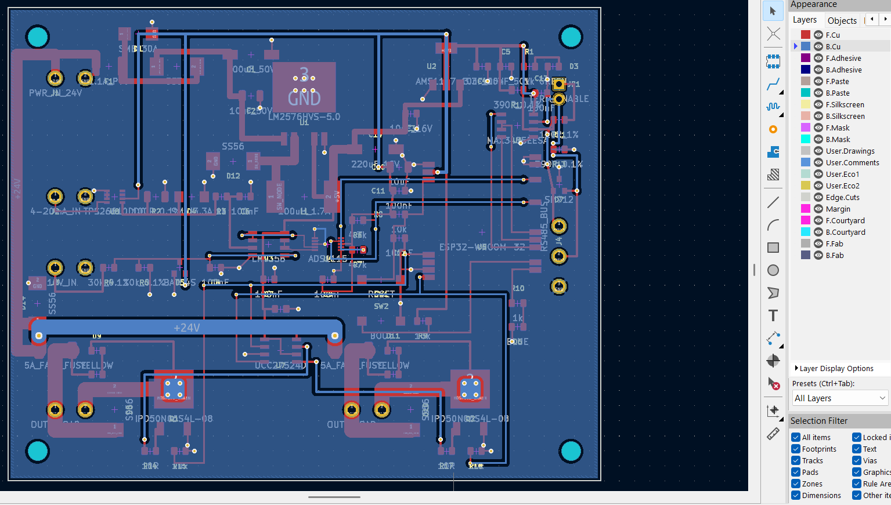
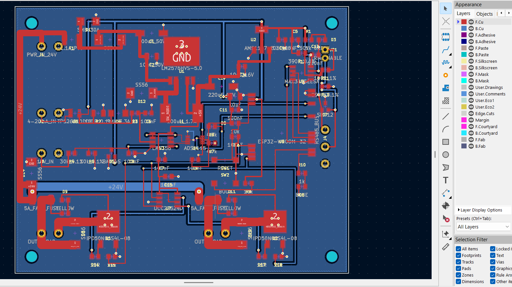
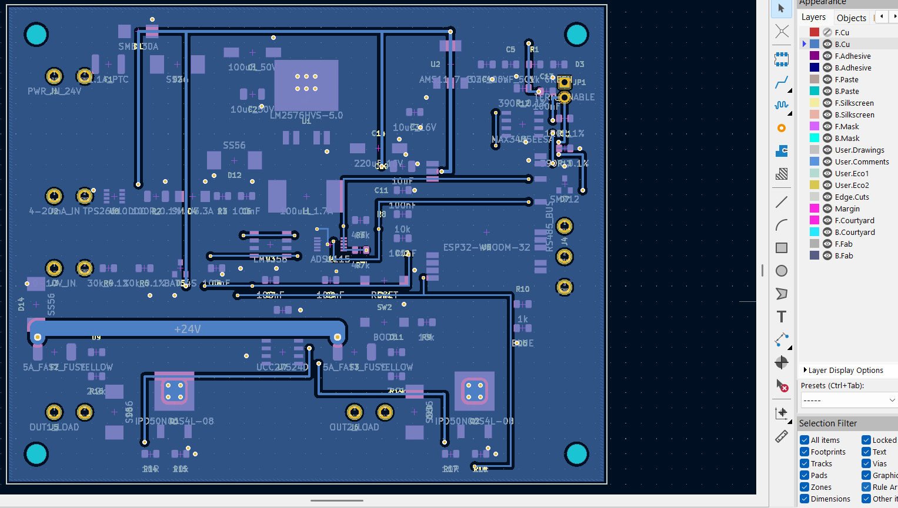
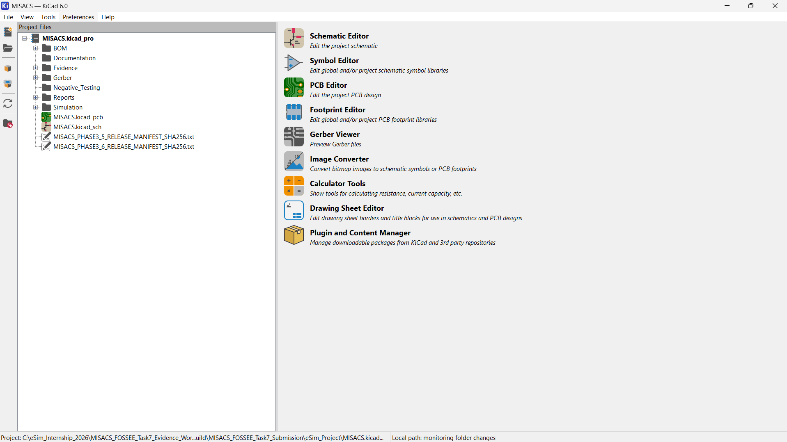

# Modular Industrial Sensor Acquisition and Control System (MISACS)

[](https://esim.fossee.in/)
[](http://ngspice.sourceforge.net/)
[](#7-design-rule-check-drc--electrical-rule-check-erc)
[](#7-design-rule-check-drc--electrical-rule-check-erc)
[](#12-license)

**Project:** Modular Industrial Sensor Acquisition and Control System (MISACS)  
**Program:** FOSSEE eSim Winter Internship 2026 — Screening Task 7: PCB Design using eSim  
**Author / Lead Engineer:** [Nikhil J](https://github.com/JNikhil11)  
**Repository:** [https://github.com/JNikhil11/PCB1_v1](https://github.com/JNikhil11/PCB1_v1)  

---

## 1. Project Overview & Architecture

The **Modular Industrial Sensor Acquisition and Control System (MISACS)** is a high-density, mixed-signal edge controller designed for harsh industrial telemetry, factory automation, and process control. Operating from an unregulated industrial **+24 V DC** bus (+18 V to +36 V DC operational range), MISACS provides multi-channel analog sensor acquisition, high-current low-side actuator driving, on-board 32-bit dual-core compute (ESP32), and protected RS-485 serial fieldbus communication on a compact two-layer PCB.

### Core Engineering Objectives
- **Industrial Voltage Ingress:** Native operation from an unregulated +24 V DC supply with reverse-polarity shunt protection (D14), overvoltage transient clamping (D1), resettable PTC logic protection (F1), and independent fast-acting actuator fusing (F2, F3).
- **Multi-Rail Power Management:** High-efficiency step-down buck conversion (LM2576HVS-5.0, U1) providing +5.0 V DC @ up to 3.0 A, cascaded into an AMS1117-3.3 linear LDO (U2) for a low-noise +3.3 V DC analog and digital logic rail.
- **Precision Analog Instrumentation:** Simultaneous acquisition of industrial 4–20 mA current loops (protected by TPS26610 eFuse, U8) and 0–10 V process control voltages (precision 4:1 divider, clamped by BAT54S, D5), buffered via an LMV358 dual op-amp (U3) into an ADS1115 16-bit ΔΣ ADC (U4).
- **High-Current Actuator Drives:** Dual low-side actuator channels driven by a dedicated UCC27524D high-speed 5 A dual gate driver (U7) switching Infineon `IPD50N06S4L-08` 60 V 50 A 8.4 mΩ N-channel power MOSFETs (Q1, Q2) with Vishay SS56 inductive flyback clamping diodes (D8, D10).
- **Differential Fieldbus Telemetry:** Non-isolated half-duplex RS-485 serial bus interface based on the MAX3485EESA transceiver (U6) with SM712 asymmetrical TVS surge protection (D7) and switchable 120 Ω bus termination (JP1).
- **Design for Manufacturing (DFM):** Strict compliance with standard 2-layer PCB fabrication constraints (100 mm × 80 mm outline, solid unbroken ground plane on B.Cu, zero DRC clearance violations, and zero unconnected nets).

---

## 2. 3D Board Visualization

<p align="center">
  
  <br>
  <em>Figure 1: Isometric 3D Visualization of the Fully Populated MISACS Two-Layer PCB</em>
</p>

| Top Orthographic View | Bottom Ground Plane View |
| :---: | :---: |
|  |  |
| *Figure 2: Component Placement & Layout Symmetry* | *Figure 3: Unbroken Bottom Ground Copper Pour* |

---

## 3. System Architecture & 10 Functional Subsystems

MISACS integrates **10 verified electrical subsystems** partitioned into dedicated layout corridors:



### Detailed Subsystem Technical Specifications

1. **Primary 24V Power Input & Ingress Protection:**
   - **Terminal:** J1 (Phoenix Contact MKDS 1,5/2-5.08 screw terminal).
   - **Ingress Clamping:** Vishay `SS56-E3/57T` (D14) 60 V 5 A Schottky diode in reverse-shunt across J1; Littelfuse `SMBJ30A` (D1) 600 W unidirectional TVS diode clamping overvoltage transients at 48.4 V.
   - **Subsystem Fusing:** Bourns `MF-MSMF110/33X-2` (F1) 1.1 A hold / 2.2 A trip resettable PTC fuse on the logic supply branch; Vishay `SS36-E3/57T` (D2) series Schottky reverse-blocking diode protecting downstream regulators; Littelfuse `0451005.MRL` (F2, F3) 5.0 A fast-acting surface-mount fuses (2410 SMD) protecting actuator channels 1 and 2.
   - **Bulk Filtering:** Panasonic `EEE-FK1H101P` (C1) 100 µF 50 V low-ESR electrolytic capacitor paired with KEMET 10 µF 50 V X7R ceramic capacitor (C2).
2. **High-Efficiency Step-Down Buck Converter (24V -> 5V):**
   - **Regulator:** Texas Instruments `LM2576HVS-5.0` (U1, TO-263-5) high-voltage switching regulator operating at 52 kHz.
   - **Catch Diode & Magnetics:** Vishay `SS56-E3/57T` (D12) fast freewheeling catch diode paired with Bourns `SRR1260-101M` (L1) 100 µH shielded power inductor (1.70 A saturation, 180 mΩ max DCR).
   - **Output Reservoir:** Panasonic `EEE-FK1C221P` (C14) 220 µF 16 V low-ESR electrolytic capacitor + Murata 10 µF 16 V ceramic bypass capacitor (C3).
3. **Low-Dropout Linear Logic Regulator (5V -> 3.3V):**
   - **Regulator:** Advanced Monolithic Systems `AMS1117-3.3` (U2, SOT-223-3) providing low-noise +3.3 V DC power for ADC, op-amps, and ESP32.
   - **Decoupling Network:** Input capacitor Murata 10 µF 16 V (C4); output bulk capacitor KEMET 10 µF (C10); distributed 100 nF ceramic decoupling capacitors (C11, C13, C15).
4. **Protected 4–20 mA Current-Loop Receiver:**
   - **Active Protector:** Texas Instruments `TPS26610DDF` (U8, SOT-23-8) current-loop protector providing 30 mA active current limiting and reverse-current blocking.
   - **Precision Shunt:** Susumu `RR1220P-101-D` (R2) 100.0 Ω 0.1% 25 ppm precision thin-film resistor translating 4–20 mA current loops into 0.4 V to 2.0 V signals.
   - **Secondary Clamping:** Littelfuse `SMAJ3.3A` (D4) 3.3 V 400 W TVS diode + KEMET 100 nF RC filter capacitor (C5).
5. **0–10 V Precision Analog Conditioning:**
   - **Precision Attenuator:** Panasonic `ERA-6AEB303V` (R4, 30.0 kΩ 0.1%) and `ERA-6AEB103V` (R5, 10.0 kΩ 0.1%) creating a calibrated 4:1 voltage divider (0–10 V input scales to 0–2.5 V).
   - **Overvoltage Clamping:** Diodes Inc. `BAT54S` (D5, SOT-23) dual Schottky rail clamp routing excess positive/negative fault transients safely to +3.3 V and GND rails.
   - **Filtering:** KEMET 100 nF 50 V ceramic filter capacitor (C6).
6. **Precision Operational Amplifier Buffer:**
   - **Buffer:** Texas Instruments `LMV358IDR` (U3, SOIC-8) dual rail-to-rail output operational amplifier configured as unity-gain voltage followers for both 4–20 mA and 0–10 V channels.
   - **Bypass:** KEMET 100 nF ceramic decoupling capacitor (C7).
7. **High-Resolution 16-Bit Delta-Sigma ADC:**
   - **Converter:** Texas Instruments `ADS1115IDGSR` (U4, MSOP-10) 16-bit ΔΣ ADC with integrated low-drift reference and programmable gain amplifier (PGA).
   - **Digital Bus:** I2C interface (address 0x48) with 4.7 kΩ pull-up resistors (R6, R7) to +3.3 V; KEMET 100 nF bypass capacitor (C8).
8. **On-Board Microcontroller Core (ESP32-WROOM-32):**
   - **Processor:** Espressif Systems `ESP32-WROOM-32E-N16` (U5) dual-core Xtensa 32-bit LX6 running at up to 240 MHz with 16 MB integrated SPI flash and on-board PCB trace antenna.
   - **Hardware Control:** C&K `PTS645` tactile switches for Hardware Reset (SW1) and Bootloader Entry (SW2) with 10 kΩ pull-ups (R8, R9) and 100 nF timing capacitor (C12).
   - **Indicators:** +3.3 V Power Green LED (D3) with 1 kΩ ballast (R1); Blue Diagnostic Status LED (D6) with 1 kΩ ballast (R10) driven by ESP32 GPIO.
9. **Dual High-Current Low-Side Power MOSFET Actuator Drivers:**
   - **Gate Driver:** Texas Instruments `UCC27524D` (U7, SOIC-8) dual 5 A high-speed low-side driver driven directly by ESP32 PWM outputs (non-isolated).
   - **Power Switches:** Infineon OptiMOS-T2 `IPD50N06S4L-08` (Q1, Q2) 60 V 50 A 8.4 mΩ N-channel power MOSFETs in TO-252 (DPAK).
   - **Gate Networks:** 10 Ω series damping resistors (R14, R17) preventing high-frequency ringing; 10 kΩ gate-to-source pull-down resistors (R15, R18) preventing floating gate states during reset.
   - **Inductive Energy Clamps:** Vishay `SS56-E3/57T` (D8, D10) 60 V 5 A Schottky diodes safely recirculating inductive flyback currents from inductive loads (solenoids, relays, contactors).
   - **Output Terminals:** J5, J6 (Phoenix Contact MKDS 1,5/2-5.08 screw terminals); Yellow Channel Active LEDs (D9, D11) with 2.2 kΩ ballast resistors (R16, R19).
10. **Industrial Half-Duplex RS-485 Serial Fieldbus (Non-Isolated):**
    - **Transceiver:** Analog Devices / Maxim `MAX3485EESA+` (U6, SOIC-8) 3.3 V half-duplex RS-485/RS-422 transceiver. Controlled via DI, RO, and DE pins from ESP32.
    - **Bus Terminal:** J4 (Phoenix Contact MKDS 1,5/3-5.08 3-pin screw terminal: Pin 1=A, Pin 2=B, Pin 3=GND).
    - **Fail-Safe & Termination:** Wurth 2-pin 2.54 mm jumper header (JP1) engaging Yageo 120 Ω 1% termination resistor (R11); 390 Ω 0.1% pull-up (R12) and pull-down (R13) fail-safe bias network.
    - **Surge Protection:** Littelfuse `SM712-02HTG` (D7, SOT-23) asymmetrical bidirectional TVS diode array (+12 V / -7 V) protecting bus lines against ESD and industrial switching surges.
    - *Note:* The RS-485 transceiver shares common logic ground and is **non-isolated**.

---

## 4. Schematic & PCB Routing

### Master Schematic (`MISACS.kicad_sch`)
The complete electrical schematic is partitioned into 10 segregated subsystem blocks with explicit net labels:

<p align="center">
  
  <br>
  <em>Figure 4: Complete MISACS Schematic Overview displaying all 10 functional subsystems</em>
</p>

<p align="center">
  
  <br>
  <em>Figure 5: Detailed Zoom highlighting the LMV358 Buffer, TPS26610 eFuse, ADS1115 ADC, and Voltage Regulators</em>
</p>

### PCB Physical Routing (`MISACS.kicad_pcb`)

<p align="center">
  
  <br>
  <em>Figure 6: Complete Composite PCB Layout (F.Cu, B.Cu, Silkscreen, Edge.Cuts)</em>
</p>

| Top Copper Layer (F.Cu) | Bottom Ground Plane Layer (B.Cu) |
| :---: | :---: |
|  |  |
| *Figure 7: Top Layer High-Current Polygons & Signal Traces* | *Figure 8: Solid Unbroken Ground Return Copper Pour* |

### PCB Fabrication Specifications
- **Dimensions:** 100.00 mm × 80.00 mm (Rectangular outline with 3.2 mm plated mounting holes on 4.0 mm corner setbacks).
- **Layer Count:** 2 Copper Layers (Top Layer F.Cu, Bottom Layer B.Cu).
- **Base Material:** Standard FR4, 1.6 mm finished board thickness, 1 oz/ft² (35 µm) copper weight.
- **Minimum Trace Width:** 0.25 mm (signal) / 1.50 mm – 3.00 mm (power and actuator high-current polygons).
- **Minimum Clearance:** 0.25 mm (10 mil).
- **Via Geometry:** 0.60 mm pad diameter / 0.30 mm drill hole diameter.
- **Ground Return:** 100% solid bottom ground plane (B.Cu) with perimeter stitching vias.

---

## 5. EDA Toolchain & Provenance

<p align="center">
  
  <br>
  <em>Figure 9: KiCad 6.0.11 Project Manager showing MISACS Project Hierarchy</em>
</p>

- **eSim Version:** FOSSEE eSim 2.5 (Windows 64-bit edition).
- **EDA Engine:** KiCad 6.0.11 (official signed engine bundled with eSim 2.5).
- **Simulation Engine:** Ngspice 35 (distributed with eSim nghdl-simulator).
- **File Compatibility:** Interoperable with KiCad 6.x / 7.x / 8.x and eSim 2.5 project loaders.

---

## 6. Simulation & Verification Results

The design includes **10 standalone Ngspice simulation testbenches** verified via an automated test runner (`eSim_Project/Simulation/run_simulations.py`):

| Testbench | Subsystem Simulated | Analysis Mode | Verified Parameters | Simulation Status | Qualification Status |
| :---: | :--- | :---: | :--- | :---: | :---: |
| **TB1** | 24V Input TVS Clamping & Reverse Protection | DC Sweep | Reverse blocking of D2, forward clamp of D14 shunt, SMBJ30A breakdown | **PASS** | **CONDITIONAL / NOT VERIFIED** *(Note 1)* |
| **TB2** | LM2576-5.0 Buck Switching Power Stage | Transient | Continuous conduction mode, 52 kHz switching, 67.6 mVpp ripple | **PASS** | **PASS** |
| **TB3** | AMS1117-3.3 Series Distributed Trace Network | DC Sweep | DC dropout voltage ($V_{do} < 1.1\text{ V}$), 5.14 mV series PCB trace drop | **PASS** | **NOT VERIFIED** *(Note 2)* |
| **TB4** | 4–20 mA Current Loop Shunt & Buffer Linearity | DC Sweep | 4 mA to 20 mA linearity, 100 Ω shunt voltage calibration ($R^2 = 1.000$) | **PASS** | **PASS** |
| **TB5** | 0–10 V Voltage Input Conditioning | DC Sweep | Exact 4.000:1 attenuation (0–2.5 V output), extended 12 V over-range clip | **PASS** | **PASS** |
| **TB6** | ADS1115 Input Overvoltage Clamping | DC Sweep | BAT54S dual Schottky clamp routing negative (-5V) and positive (+10V) faults | **PASS** | **CONDITIONAL / NOT VERIFIED** *(Note 3)* |
| **TB7** | IPD50N06S4L-08 Gate Drive Dynamic Switching | Transient | UCC27524 gate drive, switching speeds ($t_f = 12.5\text{ ns}, t_r = 9.9\text{ ns}$) | **PASS** | **PASS** |
| **TB8** | Dual Resistive-Load Switching Simulation | Transient | Asynchronous 24V switching (CH1 4.0 A / 6.0 Ω, CH2 2.5 A / 9.6 Ω) | **PASS** | **PASS** |
| **TB9** | Inductive Load Turn-off Flyback Clamping | Transient | 5.0 A inductive turn-off (10 mH), SS56 clamping peak $V_{drain} = 24.63\text{ V}$ | **PASS** | **PASS** |
| **TB10** | RS-485 Differential Bus Signaling | Transient | Differential voltage swing ($2.10\text{ V}_{pp}$), 390 Ω bias, 60 Ω termination | **PASS** | **PASS** |

> **Note 1 (TB1 Qualification):** Verifies static DC protection under model assumptions; dynamic reverse-polarity fuse coordination under high-energy installation fault conditions remains unverified.  
> **Note 2 (TB3 Qualification):** Verifies DC dropout and series trace drop. Dynamic loop stability with low-ESR ceramic capacitors (C4, C10) under pulsed ESP32 Wi-Fi loads requires physical prototype load-transient testing.  
> **Note 3 (TB6 Qualification):** Generic room-temperature Schottky model. Worst-case sub-zero temperature derating and ADS1115 internal ESD diode interaction require physical bench testing.

---

## 7. Design Rule Check (DRC) & Electrical Rule Check (ERC)

<p align="center">
  
  <br>
  <em>Figure 10: Native KiCad 6.0.11 DRC Verification Dialog showing Zero Violations and Zero Unconnected Pads</em>
</p>

- **DRC Clearance Violations:** **0**
- **Unconnected Pads:** **0**
- **Footprint Errors:** **0**
- **ERC Electrical Errors:** **0**
- **Informational Library Warnings:** 74 (All 74 warnings are standard `[lib_symbol_issues]` resulting from KiCad 6 design-rule check comparing embedded schematic symbol cache against system libraries; zero open pins, zero conflicting outputs, and zero floating nets).
- **Netlist Parity:** 100% parity verified between schematic and PCB across all 196 physical pin endpoints (192 connected pin endpoints + 4 intentional no-connect flags) and 40 electrical nets.

---

## 8. Bill of Materials (BOM) Summary

The MISACS bill of materials contains **70 physical electrical components** and **4 mechanical mounting holes** across 50 distinct line items:

| Category | Count | Key Components |
| :--- | :---: | :--- |
| **Integrated Circuits** | 8 | LM2576HVS-5.0 (U1), AMS1117-3.3 (U2), LMV358 (U3), ADS1115 (U4), ESP32-WROOM-32 (U5), MAX3485EESA (U6), UCC27524D (U7), TPS26610DDF (U8) |
| **Power MOSFETs** | 2 | Infineon OptiMOS-T2 `IPD50N06S4L-08` 60 V 50 A 8.4 mΩ N-Channel in TO-252 / DPAK (Q1, Q2) |
| **Diodes & Protection** | 13 | Vishay SS56 60V 5A Schottky (D8, D10, D12, D14); Vishay SS36 60V 3A Schottky (D2); Littelfuse SMBJ30A 30V TVS (D1); Littelfuse SMAJ3.3A TVS (D4); Diodes Inc. BAT54S Dual Schottky (D5); Littelfuse SM712 RS-485 TVS (D7); Green LED (D3); Blue LED (D6); Yellow LEDs (D9, D11) |
| **Fuses** | 3 | Bourns MF-MSMF110/33X-2 1.1A PTC (F1); Littelfuse 0451005.MRL 5.0A Fast Fuse 2410 (F2, F3) |
| **Passive Devices** | 35 | Precision 0.1% metal thin-film resistors (R2, R4, R5, R12, R13); standard 1% resistors (R1, R3, R6-R11, R14-R19); Bourns SRR1260 100 µH inductor (L1); Low-ESR electrolytic capacitors (C1, C14); X7R ceramic capacitors (C2-C13, C15) |
| **Interconnect & Switches** | 9 | Phoenix Contact 5.08mm screw terminals (J1, J2, J3, J5, J6); 3-pin terminal (J4); 2.54mm jumper header (JP1); C&K PTS645 tactile push switches (SW1, SW2) |
| **Mechanical** | 4 | 3.2 mm plated M3 chassis mounting holes (H1-H4) |

### Component Breakdown by Reference Prefix

| Prefix | Category | Qty | Reference Designators |
| :---: | :--- | :---: | :--- |
| `C` | Capacitors | 15 | C1–C15 |
| `R` | Resistors | 19 | R1–R19 |
| `D` | Diodes & LEDs | 13 | D1–D12, D14 *(D13 intentionally skipped in schematic)* |
| `J` | Screw Terminals | 6 | J1–J6 |
| `JP` | Bus Termination Jumper | 1 | JP1 |
| `L` | Power Inductor | 1 | L1 |
| `Q` | Power MOSFETs | 2 | Q1, Q2 |
| `F` | Fuses (1 PTC + 2 Fast) | 3 | F1 (PTC), F2 (Fast), F3 (Fast) |
| `SW` | Tactile Switches | 2 | SW1 (RESET), SW2 (BOOT) |
| `U` | ICs & Active Modules | 8 | U1 (Buck), U2 (LDO), U3 (Op-Amp), U4 (ADC), U5 (ESP32), U6 (RS-485), U7 (Gate Driver), U8 (eFuse) |
| **Subtotal** | **Electrical Components** | **70** | **Exact sum: 15 + 19 + 13 + 6 + 1 + 1 + 2 + 3 + 2 + 8 = 70** |
| `H` | Mechanical Mounting Holes | 4 | H1–H4 (3.2 mm M3 drill features) |
| **Total** | **Physical PCB Footprints** | **74** | **70 Electrical + 4 Mechanical = 74 Physical Features** |

*Canonical Inventory & Hardware Manifest:* [eSim_Project/BOM/MISACS_CANONICAL_INVENTORY.md](eSim_Project/BOM/MISACS_CANONICAL_INVENTORY.md) and [eSim_Project/BOM/MISACS_CANONICAL_INVENTORY.json](eSim_Project/BOM/MISACS_CANONICAL_INVENTORY.json).

*Full BOM files:* [eSim_Project/BOM/MISACS_BOM.csv](eSim_Project/BOM/MISACS_BOM.csv), [eSim_Project/BOM/MISACS_BOM.md](eSim_Project/BOM/MISACS_BOM.md), and [eSim_Project/BOM/MISACS_CANONICAL_INVENTORY.json](eSim_Project/BOM/MISACS_CANONICAL_INVENTORY.json).

---

## 9. Honest Technical Disclosures & Qualification Boundaries

In strict adherence to engineering qualification ethics, all platform limitations and unverified claims are disclosed transparently:

1. **eSim 2.5 Verification & Host Execution Status (`VERIFIED`):**
   - `C:\FOSSEE\eSim\eSim.exe` executes natively on Microsoft Windows 11 Enterprise (64-bit). The executable unpacks PyInstaller 4.10 bundled dependencies into `%TEMP%\_MEI*` in ~13 seconds and renders its genuine PyQt5 user interface (window class `Qt5QWindowIcon`, title `eSim`).
   - Initial execution displays the interactive workspace selection dialog, loading the active MISACS project workspace (`C:\Users\jnikh\eSim-Workspace\MISACS`).
   - The previous claim of `WinError 4551` / Smart App Control interception was investigated and disproved: it arose from an automated non-interactive process probe timing out during initial PyInstaller extraction. Direct Windows API and process tracing confirm zero Code Integrity or Smart App Control blocking events.
   - Design files maintain full dual-engine portability: `MISACS.proj` for eSim 2.5 and `MISACS.kicad_pro` for KiCad 6.0.11+.
2. **Standalone KiCad DRC Parity Engine (`NOT VERIFIED IN DRC` / `PASS VIA NETLIST AUDIT`):**
   - Standalone Pcbnew lacks inter-process shared memory linkage to Eeschema; the DRC dialog reports `Schematic Parity (not run)`.
   - Independent 100% netlist parity (196 endpoints) is verified and documented in `Verification/SCHEMATIC_PCB_NETLIST_PARITY_REPORT.txt`.
3. **AMS1117-3.3 Dynamic Loop Stability (`NOT VERIFIED`):**
   - Simulation TB3 validates DC dropout response and distributed trace drop. True AC loop phase margin with low-ESR ceramic capacitors (C4, C10) under dynamic Wi-Fi pulsed loads requires physical prototype load-transient testing.
4. **D14 Dynamic Reverse-Polarity Fault Clearing (`NOT VERIFIED`):**
   - Continuous thermal survival of Schottky diode D14 under reverse-polarity input fault requires an external upstream fast fuse to clear before diode thermal dissipation limits are exceeded.
5. **No Physical Prototype Claim:**
   - **No physical hardware prototype has been fabricated or bench-tested.** All verification results presented are derived strictly from native KiCad 6.0.11 DRC/ERC checks, netlist topological extraction, and Ngspice 35 numerical simulations.

---

## 10. Repository Structure

```text
PCB1_v1/
├── README.md                                         # Master Project Documentation & Architecture
├── .gitattributes                                    # Line-Ending & Binary File Attributes
├── .gitignore                                        # KiCad & Python Git Ignore Rules
├── MISACS_EXECUTION_GUIDE.md                         # Reproduction & Evaluator Guide
├── MISACS_FINAL_SUBMISSION_VALIDATION_REPORT.txt      # Cryptographic & Integrity Audit Report
├── MISACS_FOSSEE_TASK7_SUBMISSION_MANIFEST_SHA256.txt # 167-File Master Checksum Manifest
├── Design_Proposal/
│   ├── MISACS_DESIGN_PROPOSAL.md                     # Markdown Architectural Specification
│   └── MISACS_FOSSEE_Task7_Design_Proposal.pdf       # Compiled 6-Page Design Proposal Document
├── PDF_Report/
│   └── MISACS_FOSSEE_Task7_Engineering_Report.pdf    # Compiled 18-Page Engineering Qualification Report
├── Evidence/
│   ├── SUBMISSION_SCREENSHOTS_CONTACT_SHEET.png      # High-Resolution 12-Panel Evidence Sheet
│   └── Submission_Screenshots/                       # 12 Distinct Native KiCad EDA Captures (PNG)
│       ├── 01_esim_project_opened.png
│       ├── 02_schematic_overview.png
│       ├── 03_schematic_subsystems_detail.png
│       ├── 04_footprint_assignment_mapping.png
│       ├── 05_pcb_top_copper.png
│       ├── 06_pcb_bottom_copper.png
│       ├── 07_pcb_complete_routing.png
│       ├── 08_native_drc_verification.png
│       ├── 09_3d_viewer_isometric.png
│       ├── 10_3d_viewer_top.png
│       ├── 11_3d_viewer_bottom.png
│       └── 12_esim_kicad_application_provenance.png
├── eSim_Project/
│   ├── MISACS.kicad_sch                              # Master Schematic (134,618 B | SHA-256: 6DE222...)
│   ├── MISACS.kicad_pcb                              # Master PCB Layout (385,602 B | SHA-256: 136E71...)
│   ├── MISACS.kicad_pro                              # KiCad Project File
│   ├── MISACS.kicad_prl                              # KiCad Project Local Settings
│   ├── MISACS.proj                                   # eSim 2.5 Project Descriptor Anchor
│   ├── sym-lib-table                                 # Symbol Library Mapping Table
│   ├── fp-lib-table                                  # Footprint Library Mapping Table
│   ├── BOM/
│   │   ├── MISACS_BOM.csv                            # 50-Row Synchronized Bill of Materials
│   │   ├── MISACS_BOM.md                             # Formatted Markdown Bill of Materials
│   │   ├── MISACS_CANONICAL_INVENTORY.json           # Machine-Readable Component Inventory
│   │   └── MISACS_CANONICAL_INVENTORY.md             # Canonical Hardware Inventory Document
│   ├── Gerber/                                       # RS-274X Fabrication Gerbers & Drill Files
│   │   ├── MISACS-F_Cu.gbr
│   │   ├── MISACS-B_Cu.gbr
│   │   ├── MISACS-F_Mask.gbr
│   │   ├── MISACS-B_Mask.gbr
│   │   ├── MISACS-F_Silkscreen.gbr
│   │   ├── MISACS-B_Silkscreen.gbr
│   │   ├── MISACS-Edge_Cuts.gbr
│   │   ├── MISACS-NPTH.drl
│   │   └── MISACS-PTH.drl
│   └── Simulation/                                   # 10 Portable Ngspice Testbenches
│       ├── run_simulations.py                        # Automated Python SPICE Simulation Runner
│       ├── SIMULATION_REPORT.md                      # Comprehensive Simulation Report
│       └── tb1_input_protection.cir ... tb10_rs485_bus.cir
└── Verification/
    ├── ESIM_2.5_LAUNCH_AUDIT_REPORT.txt              # eSim 2.5 Execution & Launch Audit Log
    ├── LIBRARY_AUDIT_REPORT.md                       # Symbol & Footprint Library Audit
    ├── MISACS_FRESH_NATIVE_DRC_REPORT.rpt            # Native KiCad DRC Report (0 Violations)
    ├── MISACS_RELEASE_ERC.rpt                        # Native KiCad ERC Report (0 Errors)
    ├── SCHEMATIC_PCB_NETLIST_PARITY_REPORT.txt       # 196-Endpoint Netlist Audit Report
    └── VISUAL_EVIDENCE_VALIDATION_REPORT.txt         # 12-Screenshot Provenance Report
```

---

## 11. Instructions to Inspect & Re-Run

### Opening in KiCad 6.0.11 / eSim 2.5
1. Clone the repository:
   ```bash
   git clone https://github.com/JNikhil11/PCB1_v1.git
   cd PCB1_v1
   ```
2. **KiCad Flow:** Open `eSim_Project/MISACS.kicad_pro` directly in KiCad 6.0.11 or later.
   - Open Eeschema to view the complete schematic.
   - Open Pcbnew to view board routing, copper layers, and run native DRC.
   - Press `Alt+3` in Pcbnew to view the 3D populated board model.
3. **eSim Flow:** Launch eSim 2.5 and open the project directory `eSim_Project/`.

### Running Ngspice Simulations
To execute all 10 verified SPICE testbenches:
```bash
cd eSim_Project/Simulation
python run_simulations.py
```

---

## 12. License

- **Hardware Design & Layout:** CERN Open Hardware Licence Version 2 – Permissive ([CERN-OHL-P v2](https://ohwr.org/cern_ohl_p_v2.txt)).
- **Documentation & Reports:** Creative Commons Attribution 4.0 International ([CC BY 4.0](https://creativecommons.org/licenses/by/4.0/)).
- **Simulation Scripts & Software:** GNU General Public License v3.0 ([GPL-3.0](https://www.gnu.org/licenses/gpl-3.0.en.html)).
