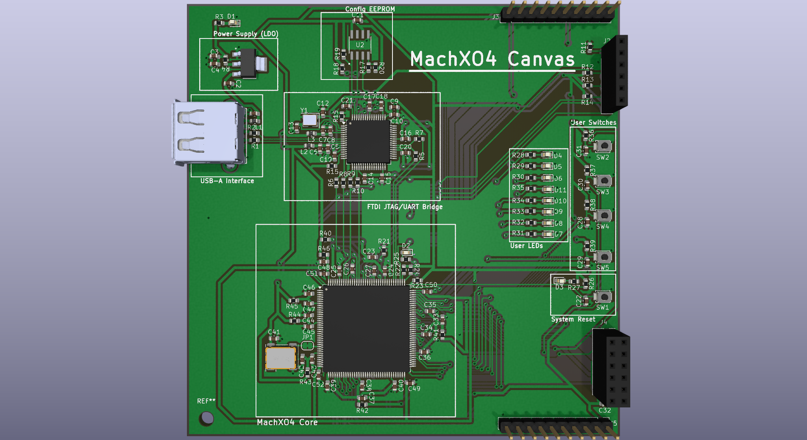
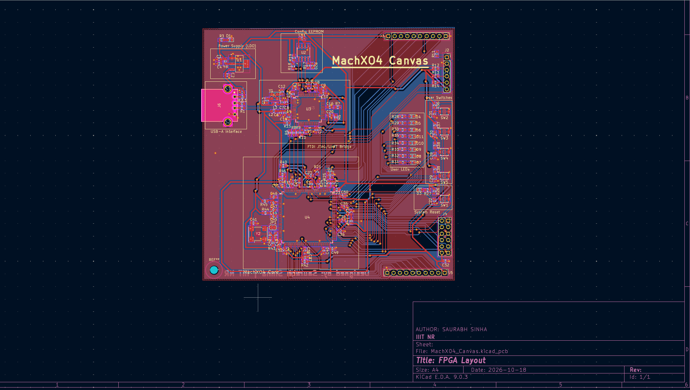
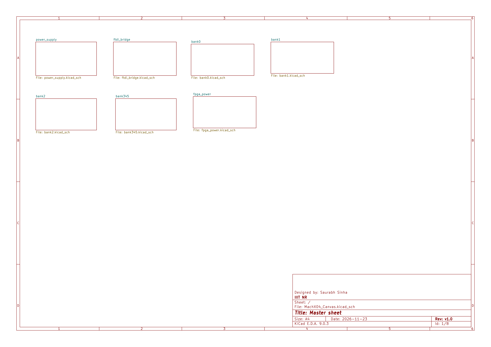

# MachXO4_Canvas — Custom 2-Layer Lattice MachXO4 FPGA Development Board

**IIT Bombay FOSSEE Winter Internship 2026 — Task 7: PCB Design using eSim (KiCad 9.0)**  
**Author:** Saurabh Sinha — Third-Year, B.Tech (Electronics & Communication Engineering), IIIT Naya Raipur  
**Verification Status:** `0 ERC Errors` • `0 DRC Errors` • `8 Hierarchical Schematic Sheets` • `100 × 100 mm 2-Layer PCB`

<p align="center">
  
  <br>
  <em>Figure 1: 3D rendered view of the MachXO4_Canvas development board showing the Lattice MachXO4-4300HC (TQFP-144), FTDI FT2232HL USB-JTAG/UART bridge, NCP1117 3.3 V LDO regulator, user LEDs, switches, and 4× bank expansion headers.</em>
</p>

> **5-Minute Technical Walkthrough & Hardware Demo:** [Watch Full Video Demonstration on Google Drive](https://drive.google.com/file/d/1bA2fzb_Q_-FsYkzUnRTprIzDjuLGJhoq/view?usp=sharing)  
> **Full Engineering Monograph (18 Pages):** [`MachXO4_Canvas_Task7_Report.pdf`](MachXO4_Canvas_Task7_Report.pdf)

---

## Why MachXO4_Canvas?

Most entry-level FPGA boards rely on external JTAG dongles, obscure fine-pitch BGAs, or opaque closed-source layouts. **MachXO4_Canvas** is a self-contained, open-source FPGA prototyping platform built entirely inside the **FOSSEE eSim / KiCad 9.0** workflow around the **Lattice MachXO4-4300HC (TQFP-144)**:

* **Single-Cable USB-JTAG & UART:** Integrated **FTDI FT2232HL** dual-channel bridge paired with a **93LC56C-I/SN** SPI configuration EEPROM—Channel A handles MPSSE JTAG bitstream programming while Channel B exposes a dedicated USB-UART telemetry port.
* **Per-Bank Power Integrity & Current Sensing:** Seven `1.0 Ω` series isolation resistors (`R40–R46`) feed `VCC_CORE` and `VCCIO0–VCCIO5` independently, damping simultaneous switching noise (SSN) and enabling non-invasive current profiling across individual I/O banks.
* **Hand-Solderable 2-Layer Architecture:** Engineered on a compact `100 × 100 mm` 2-layer stackup (`F.Cu` + `B.Cu` solid ground pours) using `0603` passives and gull-wing QFPs for straightforward lab assembly and probing.
* **Self-Contained Portable Libraries:** All 11 custom schematic symbols, SnapEDA footprints, and 3D STEP models resolve automatically via `${KIPRJMOD}` relative paths—zero manual library setup required.

---

## Hardware Architecture & Specifications

| Subsystem | Component / Parameter | Design Specification |
| :--- | :--- | :--- |
| **Core FPGA** | **Lattice MachXO4-4300HC** (`U4`) | TQFP-144 package, 4,300 LUTs, 6 independent I/O banks (`Bank 0–5`) |
| **USB-JTAG / UART** | **FTDI FT2232HL** (`U3`) + **93LC56C-I/SN** (`U2`) | Dual-channel Hi-Speed USB 2.0 bridge (Ch. A: JTAG, Ch. B: UART) |
| **Power Regulation** | **NCP1117ST33T3G** (`U1`) + `R40–R46` (`1.0 Ω`) | `+5 V` USB `VBUS` input → regulated `+3.3 V` core/I/O rails with distributed decoupling |
| **Clocking** | `Y1`, `Y2` | Dedicated on-board clock oscillator footprints feeding global clock pins |
| **User I/O & Debug** | `D1–D11`, `SW1–SW5` | 11 status/user LEDs, 4 tactile user pushbuttons, and 1 hardware reset (`4.7 kΩ / 0.1 µF` RC debounce) |
| **Expansion** | `J2–J5`, `J6` | 4× multi-bank GPIO pin headers + Type-A USB connector (`J6`) |
| **PCB Stackup & Rules** | 2-Layer (`F.Cu` / `B.Cu`) | `100 × 100 mm` outline, `0.2 mm` signal / `0.6 mm` power trace width, `0.9 / 0.5 mm` vias |
| **Verification** | KiCad 9.0 ERC & DRC | **0 Errors / 0 Unconnected Nets** (`ERC/ERC.rpt`, `ERC/DRC.rpt`) |

---

## Visual Design Gallery

| 2-Layer PCB Layout & Ground Pours | Hierarchical Root Schematic |
| :---: | :---: |
|  |  |
| *Routed `F.Cu` / `B.Cu` tracks (`0.2 mm` signal, `0.6 mm` power) with stitched ground planes.* | *8-sheet hierarchical architecture partitioning power, FT2232HL bridge, and FPGA banks.* |

---

## Quick Start in FOSSEE eSim / KiCad 9.0

1. **Clone or download** this repository (`machxo4-canvas-task7` branch).
2. Launch **FOSSEE eSim** (or **KiCad 9.0** directly) and open **`MachX04_Canvas/MachX04_Canvas.kicad_pro`**.
3. Open the **Schematic Editor**, **PCB Editor**, or **3D Viewer (`Alt+3`)**—all custom symbols (`local_symbols/`), footprints (`SnapEDA.pretty/`), and 3D STEP models (`local_3dmodels/`) load automatically via `${KIPRJMOD}`.

---

## Repository Structure

```text
MachX04_Canvas/
├── MachX04_Canvas.kicad_pro          # KiCad 9.0 project configuration
├── MachX04_Canvas.kicad_prl          # Project local settings
├── MachX04_Canvas.kicad_sch          # Hierarchical root schematic
├── MachX04_Canvas.kicad_pcb          # Routed 2-layer PCB layout (100 × 100 mm)
├── MachX04_Canvas.proj               # FOSSEE eSim project file
├── MachXO4_Canvas_Task7_Report.pdf   # 18-page technical design & verification report
├── sym-lib-table & fp-lib-table      # Portable ${KIPRJMOD} library tables
│
├── power_supply.kicad_sch            # Sub-sheet: +5 V USB VBUS to +3.3 V LDO regulator
├── ftdi_bridge.kicad_sch             # Sub-sheet: FT2232HL USB-JTAG/UART bridge & 93LC56C EEPROM
├── fpga_power.kicad_sch              # Sub-sheet: Core/bank power rails & 1.0 Ω isolation network
├── bank0.kicad_sch                   # Sub-sheet: FPGA Bank 0 I/O, LEDs & switches
├── bank1.kicad_sch                   # Sub-sheet: FPGA Bank 1 I/O, LEDs & header
├── bank2.kicad_sch                   # Sub-sheet: FPGA Bank 2 I/O, LEDs & header
├── bank345.kicad_sch                 # Sub-sheet: FPGA Banks 3/4/5 I/O, LEDs & headers
│
├── screenshots/                      # High-resolution 3D, PCB, and schematic renders
├── local_symbols/                    # 11 custom .kicad_sym symbol libraries
├── SnapEDA.pretty/                   # Custom SMD & THT footprints
├── local_3dmodels/                   # Custom 3D STEP component models
└── ERC/                              # Verified 0-error ERC.rpt and DRC.rpt logs
```

---

## References & Toolchain

* **EDA Suite:** [FOSSEE eSim](https://esim.fossee.in/) (KiCad 9.0.3)
* **FPGA Silicon:** [Lattice MachXO4 Family](https://www.latticesemi.com/Products/FPGAandCPLD/MachXO4) (`MachXO4-4300HC-5TG144C`)
* **USB Interface:** [FTDI FT2232HL Dual High-Speed USB to Multipurpose UART/FIFO IC](https://ftdichip.com/products/ft2232hl/)
