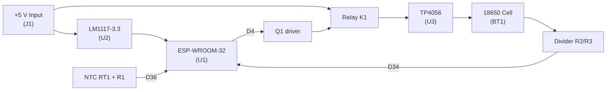

# ⚡ ESP32 Relay & Li-ion Charger Controller

**A compact ESP32-based board that monitors a Li-ion cell, charges it with a TP4056, and switches the charger supply through a relay.**

---

## 📖 Overview

This project is a compact PCB designed in **eSim 2.5 (KiCad 6.0.11)** around an **ESP-WROOM-32**. The board:

- 🌡️ measures Li-ion cell **temperature** using an NTC thermistor,
- 🔋 measures **battery voltage** through a resistor divider,
- 🔌 **charges** a single 18650 cell using a **TP4056**,
- 🔁 uses a **5 V relay** to switch the charger's supply path, driven from the ESP32.

---

## ✨ Features

| | Feature | Ref |
|---|---|---|
| 🧠 | ESP-WROOM-32 microcontroller module | `U1` |
| 🔋 | TP4056 single-cell Li-ion charger | `U3` |
| 🪫 | Keystone 1042 holder for one 18650 cell | `BT1` |
| 🔁 | 5 V relay (G5V-1-DC5) driven by a transistor from pin **D4** | `K1`, `Q1` |
| 🛡️ | 1N4007 flyback diode across the relay coil | `D1` |
| 🌡️ | NTC thermistor + 10 kΩ resistor, read on **D36** | `RT1`, `R1` |
| 📏 | Battery voltage divider (2 × 10 kΩ), read on **D34** | `R2`, `R3` |
| ⚙️ | LM1117-3.3 regulator for the 3.3 V rail | `U2` |
| 🔩 | 2-pin screw terminal for the +5 V input | `J1` |

---

## 🧩 System Block Diagram

---

## 📌 ESP32 Pin Map

| Pin | Direction | Function |
|:---:|:---:|---|
| **D4** | Output | Relay driver (via Q1) |
| **D34** | Input (ADC) | Battery voltage (R2/R3 divider) |
| **D36** | Input (ADC) | Thermistor temperature (RT1 + R1) |

---

## 📊 Design Results

| Item | Result |
|---|:---:|
| ERC | ✅ 0 errors, 0 warnings |
| DRC | ✅ 0 violations, 0 unconnected items |
| Pads / Vias / Track segments / Nets | 78 / 27 / 118 / 47 |
| Unrouted nets | 0 |
| Copper layers defined | Front, In1.Cu, In2.Cu, Back |

---

## 🖼️ Gallery

| Schematic | PCB Layout |
|:---:|:---:|
|  |  |

| DRC (0 violations) | 3D View (angled) |
|:---:|:---:|
|  |  |

---

## 🧾 Bill of Materials

| Ref | Part | Footprint |
|---|---|---|
| BT1 | 18650 holder | `Battery:BatteryHolder_Keystone_1042_1x18650` |
| D1 | 1N4007 | `Diode_SMD:D_SMA` |
| J1 | Screw terminal 1x02 | `TerminalBlock_Phoenix_MKDS-1,5-2-5.08_1x02_P5.08mm_Horizontal` |
| K1 | G5V-1-DC5 | `G5V-1:RELAY_G5V-1-DC5` |
| Q1 | BC857 | `Package_TO_SOT_SMD:SOT-23` |
| R1, R2, R3 | 10K | `Resistor_SMD:R_0805_2012Metric` |
| RT1 | NCU15WF104D60RC | `NCU15WF104D60RC:THRMC1005X55N` |
| U1 | ESP-WROOM-32 | `ESP-WROOM-32:MODULE_ESP-WROOM-32` |
| U2 | LM1117-3.3 | `Package_TO_SOT_SMD:SOT-223-3_TabPin2` |
| U3 | TP4056 | `TP4056:SOP127P600X175-9N` |

---

## 🚀 How to Open

1. Install **eSim 2.5** (includes KiCad 6.0.11).
2. Open the project in KiCad from eSim.
3. Open the **Schematic Editor** for the circuit and the **PCB Editor** for the layout.
4. Reproduce the checks:
   - Schematic: `Inspect > Electrical Rules Checker`
   - PCB: `Inspect > Design Rules Checker`
5. Inspect the board in 3D: `View > 3D Viewer`.

---

## 🛠️ Known Notes / Possible Improvements

- [ ] **Q1 polarity:** BC857 is a PNP wired as a low-side switch with its emitter to GND. Verify this; an NPN (e.g. BC847) or an N-channel MOSFET is the usual choice.
- [ ] Add a **base resistor** between D4 and Q1.
- [ ] The TP4056 **PROG pin** needs a resistor to set the charge current.
- [ ] Add **decoupling capacitors** on the LM1117 and ESP32 supply, and an **EN pull-up** for the ESP32.
- [ ] Add an **input fuse** and **reverse-polarity protection**.

---

## 📚 Documentation

See the accompanying **design report** for the schematic, footprint assignment, PCB layout, routing methodology, DRC results and 3D views.

---

## 👤 Author

**Irfan** — Electronics Engineering (VLSI Design & Technology)

⭐ If you find this project useful, consider giving it a star!

