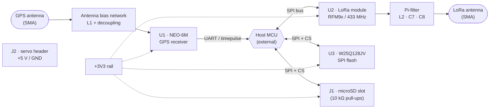

<div align="center">

# 📡 LoRa + GPS Tracker Board

### A compact KiCad PCB that combines long-range LoRa radio, GPS positioning, and on-board data storage


</div>

---

## 📖 Table of Contents

1. [What is this project?](#-what-is-this-project)
2. [Key features](#-key-features)
3. [System architecture](#-system-architecture)
4. [Schematic walkthrough](#-schematic-walkthrough)
5. [PCB layout](#-pcb-layout)
6. [3D views](#-3d-views)
7. [Main components](#-main-components)
8. [Board statistics](#-board-statistics)
9. [Things to verify before fabrication](#-things-to-verify-before-fabrication)
10. [Roadmap](#-roadmap)
11. [Repository structure](#-repository-structure)
12. [How to open the project](#-how-to-open-the-project)
13. [Author](#-author)

---

## 💡 What is this project?

Many field projects (asset trackers, rovers, drones, remote sensors) need the same three things: **know where you are**, **talk over long distances**, and **store data when there is no link**. This board puts all three on one small PCB:

| Need | Solution on the board |
|---|---|
| 📍 *Know where you are* | **u-blox NEO-6M GPS** receiver with an active-antenna power feed |
| 📡 *Talk over long distances* | **LoRa radio module** (RFM9x/RFM98W class, 433 MHz) with a pi-filter matched antenna connector |
| 💾 *Store data offline* | **W25Q128JV SPI flash** (128 Mbit) and a **microSD card slot** |
| 🔧 *Drive actuators* | A 6-pin **servo power header** supplying +5 V and GND for two servos |

Everything is hand-assemblable (0805-class passives, SOIC flash) and designed in **KiCad** from schematic through routing and 3D inspection.

> 🎯 **Goal:** a clean, reusable hardware base for GPS-tagged, LoRa-linked data logging and tracking projects.

---

## ✨ Key features

- 🛰️ **GPS positioning** with the NEO-6M and a dedicated antenna section (inductor-fed bias for an active GPS antenna, decoupled RF supply)
- 📶 **Long-range LoRa link** with a **pi-filter** (L2 + C7/C8) between the module and the SMA connector for antenna matching and filtering
- 🔌 **Two SMA connectors**, one for GPS and one for LoRa, so each radio gets its own antenna
- 💽 **Two storage options**: fast SPI flash for logs and microSD for large files
- 🔁 **Shared SPI bus** (`SPI_CLK`, `SPI_MOSI`, `SPI_MISO`) with separate chip-select lines for the LoRa module, flash and SD card
- 🧲 **Servo header** (6-pin) with +5 V and GND pairs for two servos
- 🧹 **Decoupling on every block**: 10 µF + 100 nF capacitors next to each module, with PWR_FLAGs for clean ERC
- ✅ **Fully routed**: 0 unrouted nets

---

## 🧩 System architecture



> ℹ️ The board is a **peripheral/module board**: it carries the radios and storage, and expects a host microcontroller to drive the SPI bus and read the GPS data.

---

## 📐 Schematic walkthrough

<div align="center">

<br/><sub>Schematic file: <code>project_1.kicad_sch</code> (KiCad Eeschema, A4)</sub>
</div>

The schematic is split into clearly boxed functional blocks:

| Block | What it does |
|---|---|
| **ANTENNA** (GPS) | Powers an active GPS antenna through inductor **L1** and supplies `VCC_RF`, with bulk/decoupling capacitors and a series resistor (R2) |
| **NEO-6M (GPS)** | **U1**, the u-blox GPS receiver, with its RF input, supply and backup-supply connections |
| **LoRa MODULE** | **U2**, the 433 MHz LoRa transceiver on the SPI bus (SCK, MOSI, MISO, NSS) plus RESET and DIO lines, with local decoupling |
| **PI-FILTER ANTENNA** | **L2, C7, C8** form a pi network from the LoRa RF output (`LoRa_ANT`) to SMA connector **J4** |
| **SPI FLASH** | **W25Q128JV** flash on the shared SPI bus with its own chip-select and decoupling |
| **MICRO SD SLOT** | **J1** microSD socket in SPI mode, with 10 kΩ pull-ups (R1–R7) on the card lines |
| **Servo motor ×2** | **J2**, a 6-pin terminal for two servos (+5 V and GND pairs), decoupled with C5/C6 |

---

## 🖥️ PCB layout

<div align="center">

| Front (F.Cu) | Back (B.Cu) |
|:---:|:---:|
|  |  |

</div>

**Placement logic**

- **LoRa module (U2)** sits in the centre, with its pi-filter and antenna connector on the right edge so the RF path stays short.
- **GPS module (U1)** sits in the top-right corner next to its own SMA connector and bias network.
- **SPI flash (U3), microSD (J1) and pull-ups** sit on the left, close to the shared SPI lines.
- **Servo header (J2)** sits along the top-left edge for easy cable access.
- **Decoupling capacitors** are placed beside the pins they serve (C2, C4, C9, C10 near the LoRa/flash area, C11/C12 beside the LoRa module).
- Ground copper is poured on both layers to give the RF sections a solid return path.

---

## 🧊 3D views

<div align="center">

| Top | Bottom |
|:---:|:---:|
|  |  |

</div>

The top side carries all components: the microSD socket, SPI flash, LoRa module, GPS module, passives, and both SMA connectors. The bottom side carries the through-hole pins of the servo header and the remaining routing.

---

## 🧾 Main components

| Ref | Part | Function |
|---|---|---|
| U1 | u-blox **NEO-6M** | GPS receiver |
| U2 | **LoRa module** (RFM9x/RFM98W family, 433 MHz) | Long-range radio |
| U3 | **W25Q128JV** (SOIC-8) | 128 Mbit SPI flash |
| J1 | **microSD** socket | Removable storage |
| J2 | 6-pin terminal | Servo power (+5 V / GND ×2) |
| J3 | SMA, Molex 73251-1153 (edge-mount) | Antenna connector |
| J4 | SMA coaxial connector | LoRa antenna connector (after pi-filter) |
| L1 | Inductor | Active-antenna bias feed |
| L2, C7, C8 | Inductor + capacitors | Pi-filter / antenna matching |
| R1–R7 | 10 kΩ | microSD pull-ups |
| C1–C12 | 10 µF / 100 nF | Decoupling and filtering |

---

## 📊 Board statistics

From the KiCad PCB Editor status bar:

| Metric | Value |
|---|---|
| Pads | **134** |
| Vias | **30** |
| Track segments | **204** |
| Nets | **42** |
| Unrouted | **0** ✅ |
| Layers | 2 (Front + Back) |

---

## ✅ Things to verify before fabrication

A README that is honest saves time later. These points came up while reviewing the schematic and layout images, so **check them against your project files** before ordering boards:

| # | Check | Why |
|---|---|---|
| 1 | **3.3 V source.** The `+3V3` rail has PWR_FLAGs but no regulator is visible in the schematic. Confirm where 3.3 V comes from (external supply, host board, or a regulator you still need to add). | GPS, LoRa, flash and SD all run from `+3V3`, while the servo header provides `+5V`. |
| 2 | **Servo signal pins.** On J2, pins 3 and 6 are marked with no-connect flags, and only the +5 V / GND pins appear wired. | If these are meant to be servo signal lines, they need nets to a host connection. |
| 3 | **Host connection.** No header exposing SPI, GPS UART and chip-select lines is visible in the captures. | The board needs a way to reach the host MCU (header, castellations, or an MCU on the board). |
| 4 | **Component values.** Some values (R2, L1, L2, C7, C8) are hard to read in the screenshots. | Fill them in and double-check the pi-filter values for 433 MHz and the L1 bias inductor for the chosen GPS antenna. |
| 5 | **Antenna and RF layout.** Check trace impedance (about 50 Ω) from the LoRa module to the SMA connector and the GPS RF input. | Poor RF routing hurts range and GPS sensitivity. |
| 6 | **ERC / DRC.** Run both and commit the reports. | Confirms the 0-unrouted status is also clean on clearances. |
| 7 | **Footprint check on connectors.** Confirm J3/J4 footprints match the actual SMA parts you will buy (edge-mount vs through-hole). | Avoids a mechanical mismatch at assembly. |

---

## 🛣️ Roadmap

- [ ] Add a 3.3 V regulator (or document the external 3.3 V input)
- [ ] Add a host header exposing SPI, GPS UART, CS, RESET and DIO lines
- [ ] Wire the servo signal lines
- [ ] Add mounting holes
- [ ] Add board-level ESD / reverse-polarity protection on the supply input
- [ ] Add status LEDs (GPS fix, LoRa TX/RX)
- [ ] Generate Gerbers, a BOM and an assembly drawing
- [ ] Write example firmware (GPS read → store to flash/SD → send over LoRa)
- [ ] Add a range test and results to this README

---

## 📁 Repository structure

```
lora-gps-pcb/
├── README.md                ← you are here
├── project_1.kicad_pro      ← KiCad project (add your files)
├── project_1.kicad_sch      ← schematic
├── project_1.kicad_pcb      ← PCB layout
└── images/
    ├── schematic.jpeg
    ├── layout_front.jpeg
    ├── layout_back.jpeg
    ├── 3D_front.jpeg
    └── 3D_back.jpeg
```

> 💡 Do **not** commit the `fp-info-cache` file. It is an auto-generated KiCad footprint library cache. Add it to a `.gitignore`.

---

## 🚀 How to open the project

1. Install **[KiCad 6.0 or newer](https://www.kicad.org/download/)**.
2. Clone the repo:
   ```bash
   git clone https://github.com/<your-username>/<your-repo>.git
   cd <your-repo>
   ```
3. Open `project_1.kicad_pro` in KiCad, then use:
   - **Schematic Editor** for the circuit
   - **PCB Editor** for the layout
   - **3D Viewer** (`Alt + 3`) to inspect the assembled board
4. Run **ERC** and **DRC** before exporting Gerbers.

---

## 🛠️ Tools used

| Tool | Purpose |
|---|---|
| KiCad (Schematic Editor, PCB Editor, 3D Viewer) | Design, layout and inspection |
| eSim project workflow | Project management |

---

## 👤 Author

**Shathish**
B.E. Electronics & Communication Engineering (VLSI Design Technology), Chennai Institute of Technology

---

<div align="center">

If this project is useful to you, consider giving it a ⭐

*Built with KiCad · Open for improvement*

</div>
