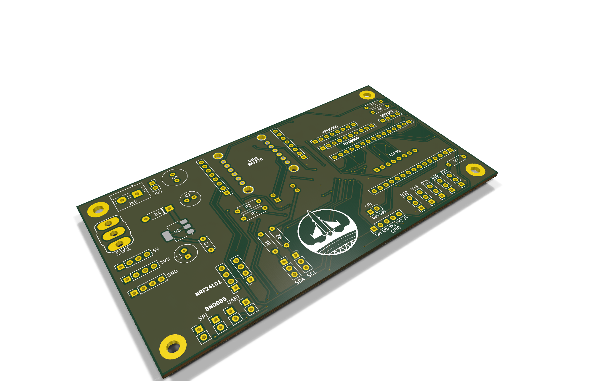

# RnA Rocket Flight Computer: eSim PCB Design (Task 7)

**eSim Semester Long Internship, Autumn 2026: Submission Task 7**
Adi Singh, IIT Patna (Avionics Division, Rocketry and Aviation Club)

A 2-layer ESP32 carrier board that serves as the flight computer for RnA's experimental model rockets. It provides IMUs, a barometer, micro-SD logging, LoRa/NRF24 telemetry, five servo outputs and a protected 5 V / 3.3 V power path.



## Quick facts

| | |
|---|---|
| Tool | eSim 2.6 (KiCad 10.0.7 back-end) |
| Board | 120 × 65 mm, 2 copper layers (F.Cu, B.Cu), GND pour on both layers |
| Parts | 48 footprints (ESP32 DevKit sockets, BNO085, MPU6050/MPU6500, BMP280, micro-SD, SX1278 LoRa / NRF24L01, 5 servo headers, LM1117-3.3 LDO) |
| Routing | 480 track segments, 70 vias (0.6/0.3 mm); 1.0 mm power, 0.5 mm 3V3, 0.25 mm signal |
| DRC | **0 violations, 0 unconnected pads, 0 schematic-parity issues** |
| ERC | **0 errors** (8 reviewed, intentional warnings; see report §7) |

## Repository layout

```
RnA_Flight_Computer/            <- eSim project (open this folder in eSim)
  RnA_Flight_Computer.proj        eSim project anchor
  RnA_Flight_Computer.kicad_pro   KiCad project
  RnA_Flight_Computer.kicad_sch   schematic
  RnA_Flight_Computer.kicad_pcb   PCB layout
  RnA_Flight_Computer.kicad_prl   project local settings
  sym-lib-table, fp-lib-table     project-local library tables (${KIPRJMOD})
  libs/                           custom symbols, footprints, 3D model
docs/
  RnA_Flight_Computer_PCB_Report.pdf     full design report
  RnA_Flight_Computer_PCB_Proposal.pdf   design proposal
  images/                                schematic, layout and 3D screenshots
outputs/
  schematic.pdf, BOM.csv, RnA_Flight_Computer.net
  DRC.rpt, ERC.rpt
  RnA_Flight_Computer_Gerbers.zip        Gerber + Excellon drill files
  pcb_*.svg                              layer plots
```

## Opening the project

1. In eSim: **Open Project** → select the `RnA_Flight_Computer/` folder.
2. **Schematic Editor** opens `RnA_Flight_Computer.kicad_sch`. **PCB Editor** opens the layout, where *Tools → Update PCB from Schematic* reports no changes.
3. *Inspect → Design Rules Checker* shows 0 errors. *View → 3D Viewer* shows the board render.

All non-standard symbols, footprints and the BNO085 3D model are bundled in `libs/` and referenced through project-local library tables, so the project opens without missing libraries.

## Design flow followed

Schematic in eSchema → footprint assignment → Update PCB from Schematic → manual 2-layer routing → DRC/ERC → 3D Viewer. Details, screenshots and design reasoning are in [the report](docs/RnA_Flight_Computer_PCB_Report.pdf).
