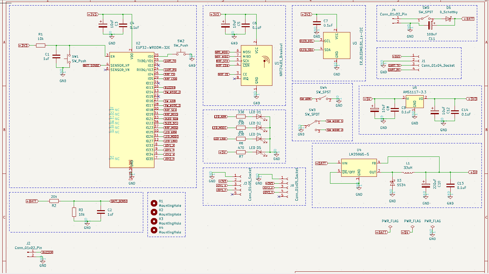
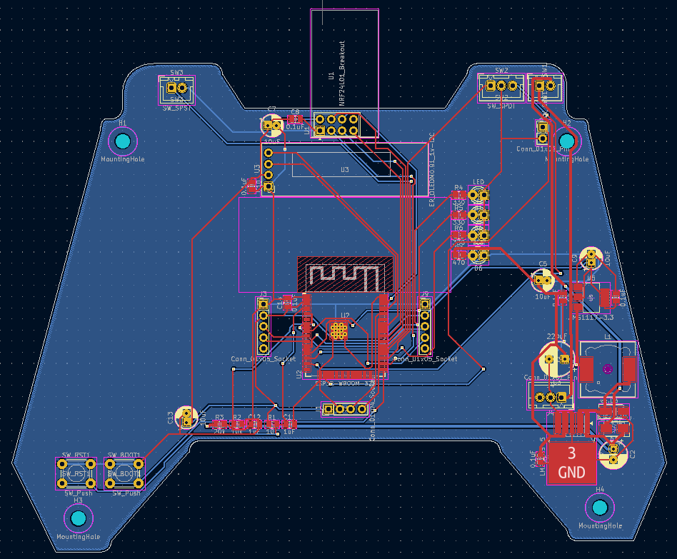
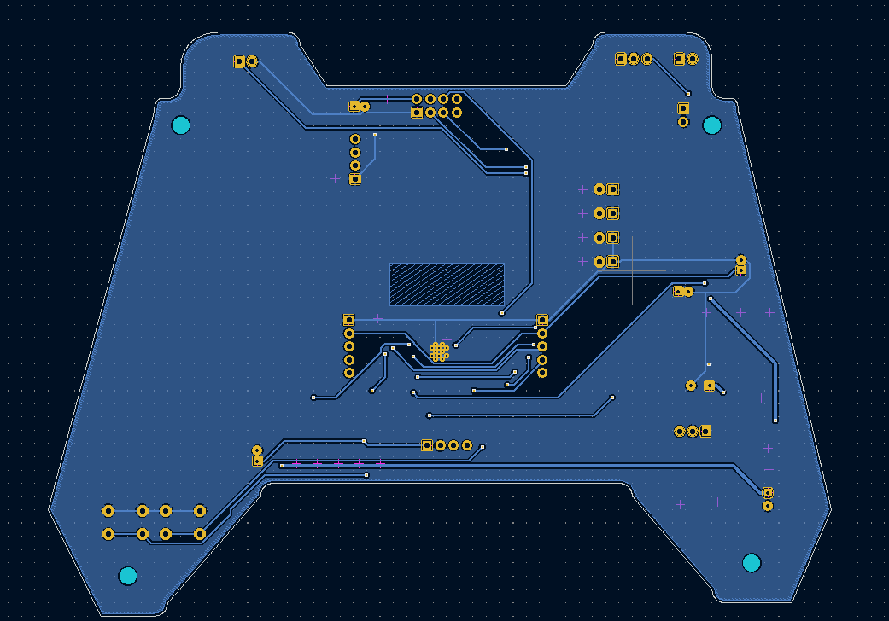
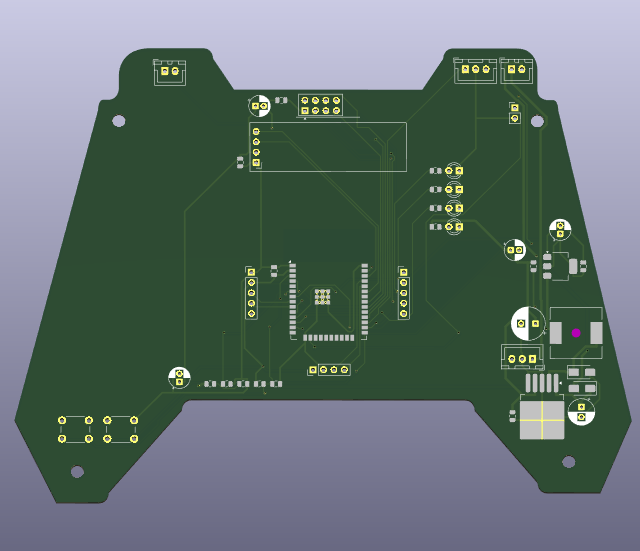
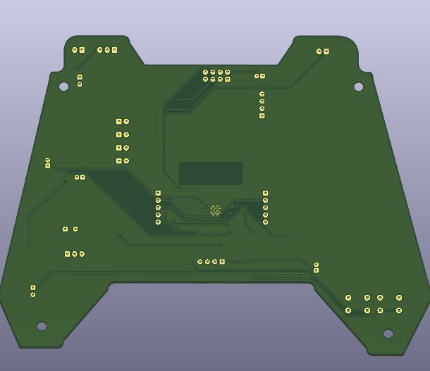
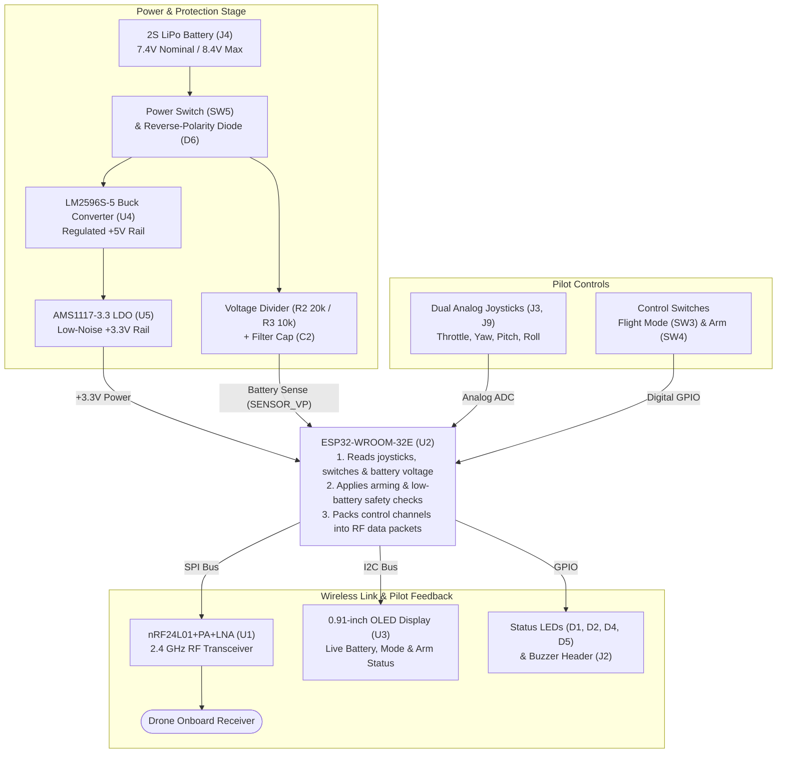

# Custom 2.4 GHz Ergonomic Drone RC Transmitter (2-Layer PCB)

A custom handheld 2.4 GHz radio-control (RC) transmitter PCB designed for quadcopters and UAVs using **eSim (KiCad-based PCB workflow)**. The board integrates an **ESP32-WROOM-32E** microcontroller, an **nRF24L01+PA+LNA** long-range transceiver, dual analog joysticks, flight-mode switches, and an OLED telemetry display on a compact, gamepad-shaped 2-layer FR4 board.

**Author:** MD Hazijul Haque  
**Program:** FOSSEE eSim Winter Internship 2026 (Task 7)  
**Project Folder:** `Transmitter_task7/`  
**Full PDF Report:** [View Task 7 Design Report (PDF)](./esim%20Task_7%20Report%20on%20Design%20and%202-Layer%20PCB%20Transmitter.pdf)  
**Forked Repository (Task 7 Branch):** [Hazijul/eSim_PCB_Design_Hot_Swap_File (task7-esp32-transmitter)](https://github.com/Hazijul/eSim_PCB_Design_Hot_Swap_File/tree/task7-esp32-transmitter/Transmitter_task7)  
**Pull Request:** [FOSSEE/eSim_PCB_Design_Project_Files #61](https://github.com/FOSSEE/eSim_PCB_Design_Project_Files/pull/61)

---

## Hardware Specifications

| Parameter | Specification |
| :--- | :--- |
| **Microcontroller** | ESP32-WROOM-32E (`U2`) |
| **RF Module** | nRF24L01+PA+LNA 2.4 GHz Transceiver (`U1`, SPI) |
| **Display** | 0.91" I2C OLED Telemetry Screen (`U3`) |
| **Power Input** | 2S LiPo Battery (`J4`, 7.4 V nominal / 8.4 V max) |
| **Voltage Rails** | `+5V` via LM2596S-5 Buck (`U4`), `+3V3` via AMS1117-3.3 LDO (`U5`) |
| **Controls** | 2x Dual-Axis Analog Joysticks (`J3`, `J9`), Arm & Mode Switches (`SW3`, `SW4`) |
| **PCB Stackup** | 2-Layer FR4, 1.6 mm thickness, 1 oz copper (`F.Cu` & `B.Cu`) |
| **Component Count** | 47 components (including 4 mounting holes `H1`–`H4`) |

---

## Schematic Explanation

The schematic (`Transmitter_task7.kicad_sch`) is organized into four functional blocks so that power, control, communication, and user feedback stay clean and easy to debug.

### 1. Power Supply & Protection Stage
* **Battery Input & Safety:** A 2S LiPo battery connects through header `J4` and main power switch `SW5`. A Schottky diode (`D6`) provides reverse-polarity protection so an accidentally reversed battery will not damage the board.
* **Two-Stage Regulation:** The battery voltage first steps down to a stable **`+5V`** rail through the `LM2596S-5` switching buck converter (`U4`). From `+5V`, an `AMS1117-3.3` linear regulator (`U5`) generates a low-noise **`+3V3`** rail to safely power the ESP32, RF transceiver, and OLED display.

### 2. Battery Voltage Sensing
* To monitor battery health without exceeding the ESP32's 3.3 V ADC limit, a resistor voltage divider made of **`R2` (20 kΩ)** and **`R3` (10 kΩ)** scales the 2S LiPo voltage down by one-third (8.4 V max becomes **2.8 V**).
* A filter capacitor (`C2`) smooths out voltage spikes before feeding the signal into **`SENSOR_VP` (Pin 4)** of the ESP32.

### 3. Microcontroller & Wireless Communication
* The **ESP32-WROOM-32E (`U2`)** acts as the central controller, reading all pilot inputs and driving the radio and display.
* The **nRF24L01+PA+LNA (`U1`)** connects to the ESP32 over the **SPI** bus for fast, low-latency 2.4 GHz packet transmission.
* A dedicated **UART header (`J1`)** along with tactile **Reset (`SW1`)** and **Boot (`SW2`)** buttons allow easy firmware flashing and serial debugging.

### 4. Pilot Controls & Telemetry Feedback
* **Joysticks (`J3`, `J9`):** Two 5-pin socket headers connect the left and right analog joysticks (Throttle, Yaw, Pitch, Roll) to the ESP32 ADC pins.
* **Switches (`SW3`, `SW4`):** A 3-way SPDT toggle switch (`SW3`) selects flight modes, while an SPST toggle switch (`SW4`) handles arming and disarming.
* **Display & Alerts:** A **0.91" I2C OLED (`U3`)** displays live battery voltage, arming status, and flight mode. Four status LEDs (`D1`, `D2`, `D4`, `D5`) and a **buzzer header (`J2`)** provide instant visual and audible alerts.

### Circuit Schematic

---

## PCB Design & Layout Explanation

The 2-layer PCB (`Transmitter_task7.kicad_pcb`) is designed to balance **handheld comfort**, **clean wireless range**, and **noise-free analog readings**. Even if you are new to PCB design, the board can be understood by breaking it down into five core design decisions:

### 1. Gamepad-Style Layout & Ergonomics
Instead of a plain rectangular board, the PCB outline is shaped like a handheld game controller so it feels natural during flight:
* **Dual Joysticks (`J3`, `J9`):** Placed symmetrically on the left and right sides so they rest directly under your thumbs.
* **OLED Display (`U3`):** Positioned at the top center where you can glance at battery voltage and flight mode without your hands blocking the screen.
* **Control Switches (`SW3`, `SW4`):** Placed within easy finger reach for quick mode changes and arming/disarming.
* **Mounting Holes (`H1`–`H4`):** Four corner mounting holes let you bolt the PCB securely inside a 3D-printed enclosure without flexing the board.

### 2. Separating "Noisy" Power from "Sensitive" Signals
In electronics, switching voltage regulators like the **`LM2596S-5` (`U4`)** work by rapidly turning current on and off thousands of times per second. That switching action creates electrical noise (electromagnetic interference) that can corrupt nearby signals.
* **Dedicated Power Zone:** The buck converter (`U4`), its inductor, diode, and bulk capacitors are grouped tightly together in the **lower-right grip**.
* **Why This Matters:** Keeping high-current switching loops far away from the **analog joystick lines** prevents random "jitter" in your throttle/steering values, and keeping them away from the **RF section** prevents interference with the 2.4 GHz radio link.

### 3. RF Antenna Keep-Out Zone
Wireless modules (`ESP32-WROOM-32E` and `nRF24L01+PA+LNA`) rely on electromagnetic waves radiating freely from their antennas. If you place copper pours or signal traces directly underneath or right next to an antenna, the metal acts like a shield and absorbs the signal.
* **Clearance Around the Antenna:** No copper ground pours, power tracks, or signal lines are routed in the antenna keep-out area.
* **Result:** Cleaner 2.4 GHz radiation, less signal detuning, and better real-world control range for the drone.

### 4. 2-Layer Routing Strategy (`F.Cu` & `B.Cu`)
A 2-layer PCB has two copper sides: the **Front Copper (`F.Cu`)** on top and the **Back Copper (`B.Cu`)** on the bottom.
* **Short, Direct Signal Paths:** High-speed digital lines—like **SPI** (to the `nRF24L01+PA+LNA`) and **I2C** (to the `0.91"` OLED)—are kept as short and direct as possible to prevent signal distortion.
* **Decoupling Capacitors Near Power Pins:** Small filter capacitors are placed right next to the power pins of the ESP32 and regulators. Think of them as tiny local energy reservoirs that absorb sudden power spikes so the microcontroller never browns out or resets mid-flight.
* **Solid Ground Reference:** A continuous ground copper pour gives electrical current a short, low-resistance return path back to the battery, which stabilizes voltage levels and reduces overall noise.

### 5. Design Verification (ERC & DRC)
Before a PCB is ever sent to a factory, two automated checks ensure it will actually work and can be manufactured reliably:
* **Electrical Rules Check (`ERC.rpt`):** Checks the schematic for logical wiring mistakes—such as unconnected pins, accidental short circuits between power and ground, or missing power flags.
* **Design Rules Check (`DRC.rpt`):** Checks the physical PCB layout against manufacturing limits—making sure traces aren't too thin, copper paths aren't too close together, and pads/holes have safe clearance so the board fabricates cleanly without shorts.

### Quick Summary of PCB Zones

| Board Area | Key Components | Design Purpose |
| :--- | :--- | :--- |
| **Lower-Right Grip** | `U4` (LM2596S-5), power passives | Isolates switching power noise from sensitive circuits |
| **Center & Top Edge** | `U2` (ESP32), `U1` (nRF24L01), `U3` (OLED) | Short SPI/I2C routing, clear screen view, unobstructed RF antenna |
| **Left & Right Thumb Areas** | `J3`, `J9` (Joysticks), `SW3`, `SW4` | Comfortable thumb/finger ergonomics for flight control |
| **Board Corners** | `H1`–`H4` (Mounting Holes) | Mechanical stability inside a 3D-printed controller shell |
  
### 2-Layer PCB Layout (Front & Back)

  
  

### 3D PCB Render (Front & Back)

  
  

---

## System Working Flow

### Stage-by-Stage Operation

| Stage | Components Involved | Function |
| :--- | :--- | :--- |
| **1. Power & Protection** | `J4`, `SW5`, `D6`, `U4`, `U5` | Turning on `SW5` routes 2S LiPo power through reverse-polarity diode `D6`. The `LM2596S-5` buck converter (`U4`) steps it down to `+5V`, and the `AMS1117-3.3` LDO (`U5`) supplies a clean `+3.3V` rail for the controller, radio, and display. |
| **2. Input & Battery Sensing** | `J3`, `J9`, `SW3`, `SW4`, `R2`, `R3`, `C2` | The ESP32 continuously reads analog joystick positions (Throttle, Yaw, Pitch, Roll) and switch states (Mode and Arm). Simultaneously, the `R2`/`R3` voltage divider scales battery voltage safely below 3.3 V for `SENSOR_VP` (Pin 4). |
| **3. Processing & Packetizing** | `U2` (ESP32-WROOM-32E) | The microcontroller maps raw ADC values into normalized control channels, verifies arming and battery thresholds, and packs the data into a structured 2.4 GHz control packet. |
| **4. Transmission & Feedback** | `U1`, `U3`, `D1`–`D5`, `J2` | Control packets are sent over **SPI** to the `nRF24L01+PA+LNA` (`U1`) for wireless transmission to the drone. At the same time, the ESP32 updates the `0.91"` **I2C OLED** (`U3`) and triggers the status LEDs and buzzer (`J2`) for alerts. |            ▼
        Transmits RC Control Packets         Displays Telemetry & Status Alerts
             to Drone Receiver                       to the Pilot
