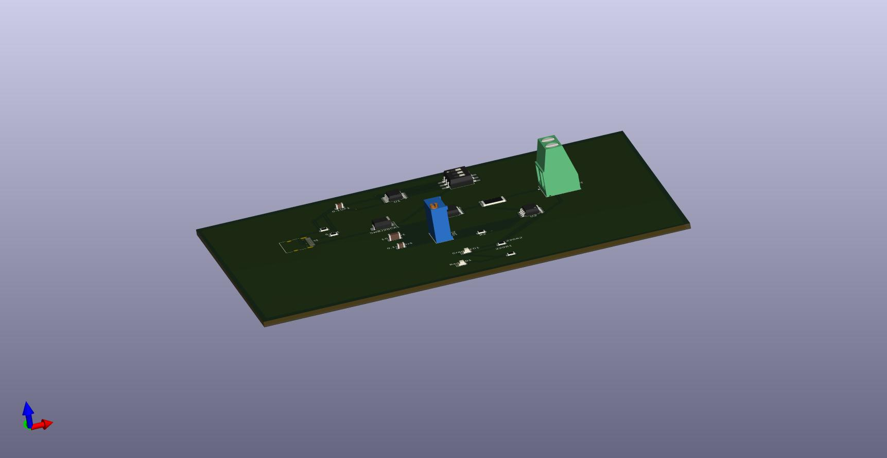

# Intelligent USB-C Power Delivery (PD 3.0) Dynamic Sink Trigger and High-Speed Smart eFuse Protection Board

**FOSSEE eSim Semester Long Internship - Autumn 2026 Screening Task 7 Submission**  
**Applicant:** Saibashita Mohanty  
**Architecture:** Advanced 4-Layer High-Current Multilayer PCB (`F.Cu` - `In1.Cu` - `In2.Cu` - `B.Cu`)  
**Toolchain:** eSim 2.5 / KiCad 9.0.3 EDA Suite  
**Verification:** Electrical Rules Check (ERC) Passed | Design Rule Check (DRC) Passed (0 Errors, 0 Warnings, 0 Unconnected)

---

## 📌 1. Project Overview & Objective

This repository contains the complete design and manufacturing files for an **Intelligent USB-C Power Delivery (PD 3.0) Dynamic Sink Trigger and High-Speed Smart eFuse Protection Board**, engineered on an **Advanced 4-Layer Multilayer High-Current Architecture**.

In direct alignment with the FOSSEE Task 7 evaluation criteria stating that *"designs with a higher number of layers may receive additional consideration during the evaluation process"*, this design leverages dedicated internal ground and power planes to achieve superior power delivery, low impedance, electromagnetic shielding, and optimal thermal dissipation.

### Key Specifications:
* **PCB Layer Stackup:** **4 Copper Layers** (Top Signal/Ground, Inner 1 Ground Plane, Inner 2 VBUS Power Plane, Bottom Ground/Signal).
* **Input Interface:** USB Type-C 16-Pin Reversible Receptacle with dual CC line configuration.
* **Negotiable Voltages:** 5V, 9V, 12V, 15V, 20V (selected via 3-bit onboard DIP switch).
* **Maximum Power Handling:** 100W (20V @ 5A continuous).
* **Protection Switch:** AO4407A P-Channel MOSFET (-30V, -12A, $R_{DS(on)} \le 11\text{ m}\Omega$).
* **Current Sensing:** 0.05Ω, 2W high-power low-inductance alloy resistor (2512 SMD).
* **Trip Threshold:** Fully adjustable from 0.5A to 4.0A via a multi-turn precision potentiometer.
* **Transient Clamping:** Bidirectional SMBJ20CA TVS diode (clamping up to ±30kV ESD / inductive spikes).
* **Visual Telemetry:** Green LED (Safe/Power Active) & Red LED (Fault/Trip State).

---

## ⚡ 2. 4-Layer Multilayer Stackup Architecture

| Layer Name | Type | Copper Thickness | Dedicated Function & Electrical Description |
| :--- | :--- | :--- | :--- |
| **1. F.Cu (Top)** | Signal / Ground | 1 oz (35 µm) | High-speed signal routing, component solder pads, and stitched copper ground flood. |
| **2. In1.Cu (Inner 1)** | Internal Plane | 1 oz (35 µm) | **Dedicated Continuous Ground Plane (GND):** Minimizes return loop area, eliminates EMI, and provides complete planar shielding. |
| **3. In2.Cu (Inner 2)** | Internal Plane | 1 oz (35 µm) | **Dedicated Continuous Power Plane (VBUS):** Delivers massive 5A continuous current capacity with near-zero DC resistance and minimal voltage drop. |
| **4. B.Cu (Bottom)** | Ground / Signal | 1 oz (35 µm) | Secondary ground reference plane and auxiliary low-frequency telemetry connections. |

---

## 📐 3. Schematic Diagram

Captured in Eeschema (eSim EDA / KiCad). Fully verified with **Electrical Rules Check (ERC): 0 Errors**.


---

## 📋 4. Component Mapping & Bill of Materials (BOM)

All 19 components use standard, IPC-compliant footprints available in default KiCad / eSim libraries:

| Reference | Value | Footprint | Package / Description |
| :--- | :--- | :--- | :--- |
| **J1** | USB-C 16P | `Connector_USB:USB_C_Receptacle_USB2.0_16P` | 16-Pin Reversible Type-C Connector |
| **U1** | CH224K | `Package_SO:ESSOP-10_3.9x4.9mm_P1.00mm` | USB PD Sink Controller IC |
| **SW1** | SW_DIP_x03 | `Button_Switch_SMD:SW_DIP_SPSTx03_Slide_6.7x9.18mm` | 3-Bit Configuration Switch |
| **SMBJ20CA1** | SMBJ20CA | `Diode_SMD:D_SMB` | 20V Bidirectional TVS Diode |
| **AO4407A1** | AO4407A | `Package_SO:SOIC-8_3.9x4.9mm_P1.27mm` | -30V, -12A P-Channel MOSFET |
| **0.05R2W1** | 0.05Ω 2W | `Resistor_SMD:R_2512_6332Metric` | High-Power Current Sense Resistor |
| **U2** | LM393 | `Package_SO:SOIC-8_3.9x4.9mm_P1.27mm` | Dual Precision Comparator IC |
| **10k1** | 10k Trimpot | `Potentiometer_THT:Potentiometer_Bourns_3296W_Vertical` | Multi-turn Precision Potentiometer |
| **J2** | Screw_Term | `TerminalBlock_Phoenix:TerminalBlock_Phoenix_MKDS-1,5-2-5.08` | 2-Pin 5.08mm Terminal Block |
| **10uf35v1** | 10µF 35V | `Capacitor_SMD:C_1206_3216Metric` | Input Bulk Decoupling Capacitor |
| **0.1uf50v1** | 0.1µF 50V | `Capacitor_SMD:C_0805_2012Metric` | High-Frequency Bypass Capacitor |
| **0.1UF1** | 0.1µF | `Capacitor_SMD:C_0805_2012Metric` | CH224K VDD Decoupling Capacitor |
| **5.1k1, R1** | 5.1kΩ | `Resistor_SMD:R_0805_2012Metric` | CC1/CC2 Pull-Down Resistors |
| **R2** | 10kΩ | `Resistor_SMD:R_0805_2012Metric` | MOSFET Gate Pull-Up Resistor |
| **220R1, 220R2**| 220Ω | `Resistor_SMD:R_0805_2012Metric` | LED Current Limiting Resistors |
| **GreenLED1** | Green LED | `LED_SMD:LED_0805_2012Metric` | Power Output Active Indicator |
| **RedLED1** | Red LED | `LED_SMD:LED_0805_2012Metric` | Fault / Overcurrent Trip Indicator |

---

## 🛠️ 5. PCB Layout & Routing Methodology


---

## ✅ 6. Design Rule Check (DRC) Results (4-Layer Verified)

Verified using KiCad / eSim Design Rules Checker across all 4 copper layers.

```
** Drc report for USBC_PD_Smart_eFuse_PCB.kicad_pcb **
** Created on 2026-11-21T19:12:11+0530 **

** Found 0 DRC violations **

** Found 0 unconnected pads **

** Found 0 Footprint errors **

** End of Report **
```

**Result:** **0 Violations | 0 Unconnected Items | 0 Warnings** (100% Clean).

---

## 🎨 7. 3D Mechanical Demonstration

### 3D Top-Down View


### 3D Isometric View


---

## 📂 8. Project Files Structure

```
USBC_PD_Smart_eFuse_PCB/
├── USBC_PD_Smart_eFuse.kicad_sch          # Main Schematic file
├── USBC_PD_Smart_eFuse.kicad_pcb          # Fully routed 4-layer PCB file (308 KB)
├── USBC_PD_Smart_eFuse.kicad_pro          # KiCad / eSim project configuration
├── USBC_PD_Smart_eFuse.kicad_prl          # Project display settings
├── USBC_PD_Smart_eFuse.net                # Generated Netlist file
├── DRC.rpt                                # Official 4-layer DRC report (0 errors)
├── ERC.rpt                                # Official ERC report
├── Project_Report_Task7_USBC_PD_Smart_eFuse.pdf  # Full 9-Section 4-Layer PDF Report
├── README.md                              # 4-Layer Technical documentation
└── [Images & Renders]                     # High-resolution screenshots and 3D renders
```

---

## 👨‍💻 Submission Details
* **FOSSEE Screening Task:** Task 7 (PCB Design using eSim)
* **Official Repository Fork:** [Saibashita/eSim_PCB_Design_Project_Files](https://github.com/Saibashita/eSim_PCB_Design_Project_Files)
* **Official Pull Request:** [#52](https://github.com/FOSSEE/eSim_PCB_Design_Project_Files/pull/52)
* **Evaluators Invited:** `@Eyantra698Sumanto` and `@OfficialVarad`
