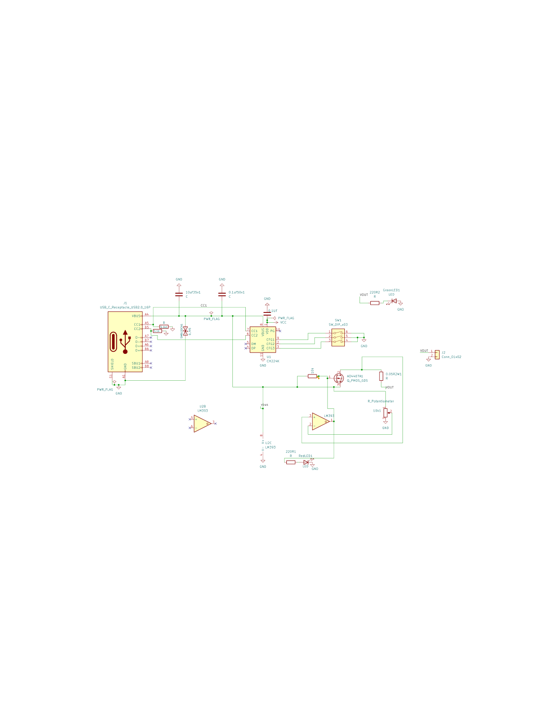
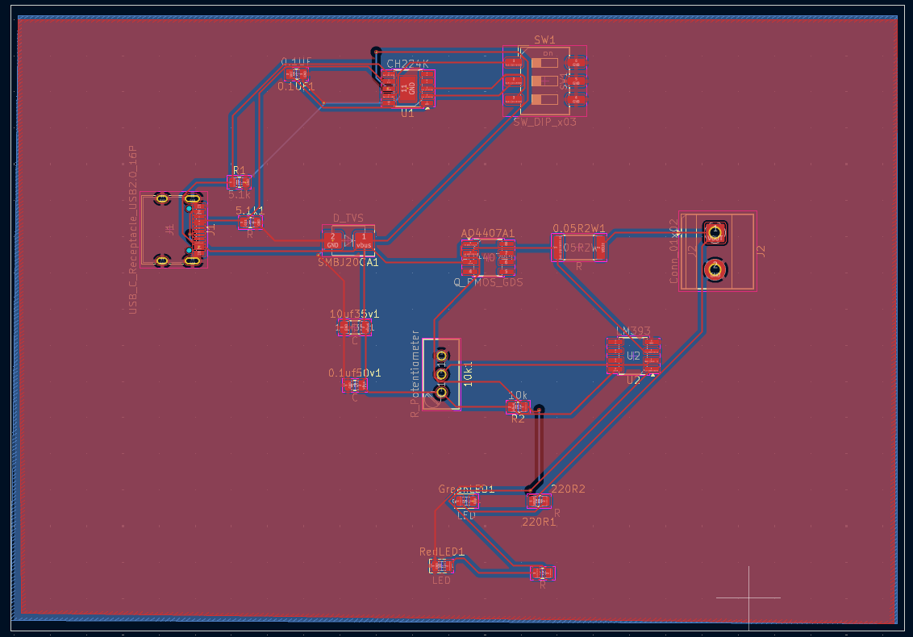
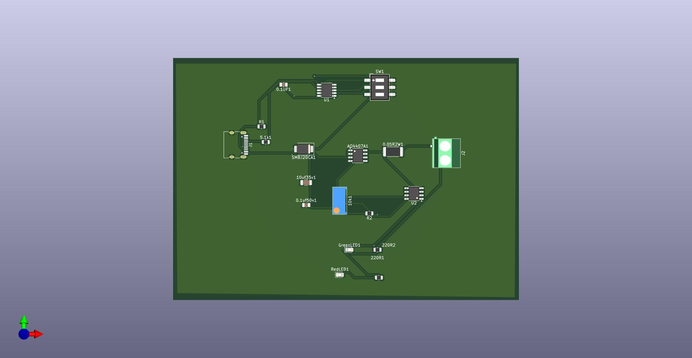

# Intelligent USB-C Power Delivery (PD 3.0) Dynamic Sink Trigger and High-Speed Smart eFuse Protection Board

**FOSSEE eSim Semester Long Internship - Autumn 2026 Screening Task 7 Submission**  
**Applicant:** Saibashita Mohanty  
**Toolchain:** eSim 2.5 / KiCad 9.0.3 EDA Suite  
**Verification:** Electrical Rules Check (ERC) Passed | Design Rule Check (DRC) Passed (0 Errors, 0 Warnings, 0 Unconnected)

---

## 📌 1. Project Overview & Objective

This repository contains the complete design and manufacturing files for an **Intelligent USB-C Power Delivery (PD 3.0) Dynamic Sink Trigger and High-Speed Smart eFuse Protection Board**. 

The board functions as a universal, programmable power receiver and solid-state circuit breaker. It enables downstream systems to dynamically request standard USB PD voltages (5V, 9V, 12V, 15V, or 20V at up to 5A / 100W) using an onboard **CH224K** hardware state-machine controller, while protecting sensitive loads against overcurrent, short circuits, and inductive transients using a sub-microsecond **Active Smart eFuse** circuit.

### Key Specifications:
* **Input Interface:** USB Type-C 16-Pin Reversible Receptacle with dual CC line configuration.
* **Negotiable Voltages:** 5V, 9V, 12V, 15V, 20V (selected via 3-bit onboard DIP switch).
* **Maximum Power Handling:** 100W (20V @ 5A continuous).
* **Protection Switch:** AO4407A P-Channel MOSFET (-30V, -12A, $R_{DS(on)} \le 11\text{ m}\Omega$).
* **Current Sensing:** 0.05Ω, 2W high-power low-inductance alloy resistor (2512 SMD).
* **Trip Threshold:** Fully adjustable from 0.5A to 4.0A via a multi-turn precision potentiometer.
* **Transient Clamping:** Bidirectional SMBJ20CA TVS diode (clamping up to ±30kV ESD / inductive spikes).
* **Visual Telemetry:** Green LED (Safe/Power Active) & Red LED (Fault/Trip State).
* **PCB Architecture:** 2-Layer FR-4 (1.6mm thickness, 1 oz copper) with continuous dual ground planes.

---

## ⚡ 2. Circuit Subsystems & Working Principle

1. **USB-C Interface & CC Logic (`J1`, `5.1k1`, `R1`):** Dual 5.1kΩ pull-down resistors on CC1 and CC2 pins advertise valid Sink status to the USB-C source and establish cable orientation.
2. **PD Protocol Trigger Controller (`U1 - CH224K`, `SW1`):** Decodes BMC PD packet contracts from the source. The onboard 3-position DIP switch sets pins CFG1, CFG2, and CFG3 to request the desired voltage profile.
3. **Transient Suppression (`SMBJ20CA1`):** Clamps high-voltage inductive switching and hot-plug surges on the VBUS rail.
4. **Active High-Side Power Switch (`AO4407A1`):** A logic-controlled P-MOSFET with minimal conduction loss ($< 100\text{ mW}$ at 3A).
5. **Precision Current Sensing (`0.05R2W1`):** Generates an accurate differential voltage drop proportional to the load current ($V_{sense} = I_{load} \times 0.05\Omega$).
6. **High-Speed Comparator & Reference (`U2 - LM393`, `10k1`):** Compares the sense voltage against an adjustable reference voltage. When load current exceeds the set threshold, the comparator trips the MOSFET Gate HIGH in microseconds.
7. **Dual-State Visual Telemetry (`GreenLED1`, `RedLED1`):** Instant visual diagnostics of power flow and fault status.
8. **Heavy-Duty Output Block (`J2`):** 5.08mm pitch screw terminal for secure wire connection to external loads.

---

## 📐 3. Schematic Diagram

Captured in Eeschema (eSim EDA / KiCad). Fully verified with **Electrical Rules Check (ERC): 0 Errors**.



---

## 📋 4. Component Mapping & Bill of Materials (BOM)

All 19 components use standard, IPC-compliant footprints available in KiCad / eSim libraries:

| Reference | Value | Footprint | Package / Description |
| :--- | :--- | :--- | :--- |
| **J1** | USB-C 16P | `Connector_USB:USB_C_Receptacle_USB2.0_16P` | 16-Pin Reversible Type-C Connector |
| **U1** | CH224K | `Package_SO:ESSOP-10_3.9x4.9mm_P1.00mm` | USB PD Sink Controller IC |
| **SW1** | SW_DIP_x03 | `Button_Switch_SMD:SW_DIP_SPSTx03_Slide_6.7x9.18mm` | 3-Bit Configuration Switch |
| **SMBJ20CA1** | SMBJ20CA | `Diode_SMD:D_SMB` | 20V Bidirectional TVS Diode |
| **AO4407A1** | AO4407A | `Package_SO:SOIC-8_3.9x4.9mm_P1.27mm` | -30V, -12A P-Channel MOSFET |
| **0.05R2W1** | 0.05Ω 2W | `Resistor_SMD:R_2512_6332Metric` | High-Power Current Sense Resistor |
| **U2** | LM393 | `Package_SO:SOIC-8_3.9x4.9mm_P1.27mm` | Dual Precision Comparator IC |
| **10k1** | 10k Trimpot | `Potentiometer_THT:Potentiometer_Bourns_3296W_Vertical` | Multi-turn Precision Potentiometer |
| **J2** | Screw_Term | `TerminalBlock_Phoenix:TerminalBlock_Phoenix_MKDS-1,5-2-5.08` | 2-Pin 5.08mm Terminal Block |
| **10uf35v1** | 10µF 35V | `Capacitor_SMD:C_1206_3216Metric` | Input Bulk Decoupling Capacitor |
| **0.1uf50v1** | 0.1µF 50V | `Capacitor_SMD:C_0805_2012Metric` | High-Frequency Bypass Capacitor |
| **0.1UF1** | 0.1µF | `Capacitor_SMD:C_0805_2012Metric` | CH224K VDD Decoupling Capacitor |
| **5.1k1, R1** | 5.1kΩ | `Resistor_SMD:R_0805_2012Metric` | CC1/CC2 Pull-Down Resistors |
| **R2** | 10kΩ | `Resistor_SMD:R_0805_2012Metric` | MOSFET Gate Pull-Up Resistor |
| **220R1, 220R2**| 220Ω | `Resistor_SMD:R_0805_2012Metric` | LED Current Limiting Resistors |
| **GreenLED1** | Green LED | `LED_SMD:LED_0805_2012Metric` | Power Output Active Indicator |
| **RedLED1** | Red LED | `LED_SMD:LED_0805_2012Metric` | Fault / Overcurrent Trip Indicator |

---

## 🛠️ 5. PCB Layout & Routing Methodology

* **Layer Stackup:** 2 Copper Layers (Top Layer `F.Cu`, Bottom Layer `B.Cu`), 1.6mm FR-4.
* **Power Trace Sizing:** Main VBUS and VOUT tracks are sized between 1.5mm – 2.0mm with solid copper fills for high current delivery.
* **Dual Ground Planes:** Both top and bottom layers are flooded with continuous `GND` copper zones, interconnected via stitching vias for low EMI and optimal heat sinking.
* **Mitered Bends:** Strictly 45° trace angles to eliminate reflections and impedance discontinuities.



---

## ✅ 6. Design Rule Check (DRC) Results

Verified using KiCad / eSim Design Rules Checker.

```
** Drc report for USBC_PD_Smart_eFuse_PCB.kicad_pcb **
** Created on 2026-11-21T18:09:07+0530 **

** Found 0 DRC violations **

** Found 0 unconnected pads **

** Found 0 Footprint errors **

** End of Report **
```

**Result:** **0 Violations | 0 Unconnected Items | 0 Warnings** (100% Error-Free).

---

## 🎨 7. 3D Mechanical Demonstration

### 3D Top-Down View


### 3D Isometric View


---

## 📂 8. Project Files Structure

```
USBC_PD_Smart_eFuse_PCB/
├── USBC_PD_Smart_eFuse.kicad_sch          # Main Schematic file
├── USBC_PD_Smart_eFuse.kicad_pcb          # Fully routed 2-layer PCB file
├── USBC_PD_Smart_eFuse.kicad_pro          # KiCad / eSim project configuration
├── USBC_PD_Smart_eFuse.kicad_prl          # Project local settings
├── USBC_PD_Smart_eFuse.net                # Generated Netlist file
├── DRC.rpt                                # Official DRC report (0 errors)
├── ERC.rpt                                # Official ERC report
├── Project_Report_Task7_USBC_PD_Smart_eFuse.pdf  # Full 9-Section PDF Report
├── README.md                              # Technical documentation
└── [Images & Renders]                     # High-resolution screenshots and 3D renders
```

---

## 👨‍💻 Submission Details
* **FOSSEE Screening Task:** Task 7 (PCB Design using eSim)
* **Official Repository Fork:** [Saibashita/eSim_PCB_Design_Project_Files](https://github.com/Saibashita/eSim_PCB_Design_Project_Files)
* **Evaluators Invited:** `@Eyantra698Sumanto` and `@OfficialVarad`
